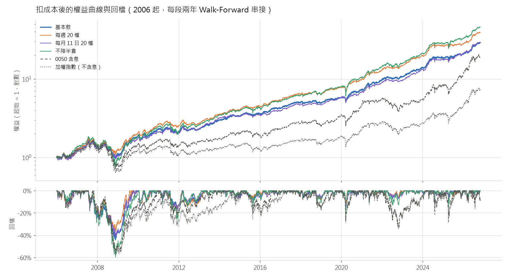
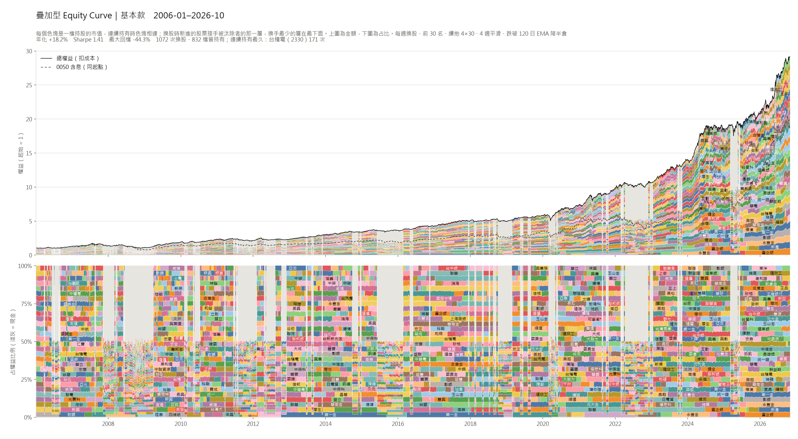
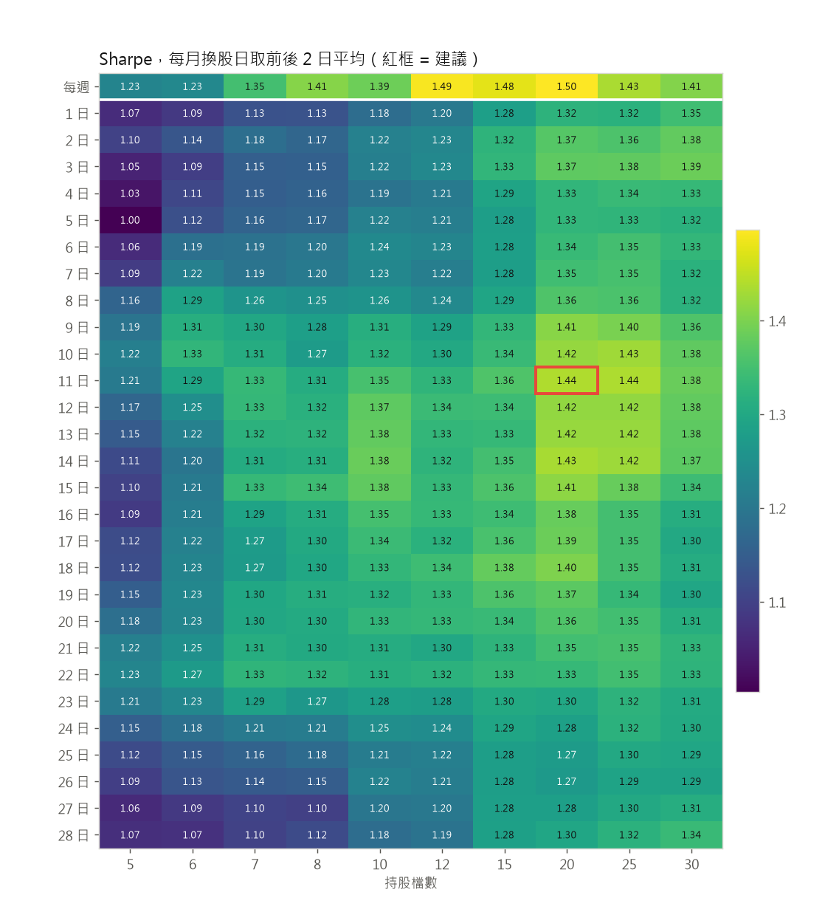

# 用 yfinance 公開資料做台股 LightGBM 排序策略

每週用 LightGBM 對台股做橫斷面排序，挑前 30 名等權重做多；加權指數跌破 120 日均線時降到半倉。
只用公開免費資料（證交所的股票清單與指數、Yahoo Finance 日 K），任何人 clone 下來都能自己重跑、驗證。

> **AI model declaration** — 本專案的設計、程式與文件由 **Claude Opus 5.5**（Anthropic）透過 Claude Code 完成。

這個 repo 重做先前另一個 LightGBM 排序研究：那個研究用私有的日 K 資料庫，2018 年以前另外加了基本面與籌碼特徵，
2019 年以後只剩價量。既然最後只用價量，這裡全部改用公開資料從頭寫，資料也從 2000 年開始，比原研究長。
需求的演進記在 [genesis/](genesis/README.md)。

## 結論

* **基本款扣成本後，2006-01 ～ 2026-10 年化 +18.2%、Sharpe 1.41**；同期 0050 含息 +15.5%、Sharpe 0.82，
  加權報酬指數（含息）+14.3%、0.79。年化波動 12.4%，只有大盤的三分之二
* **十段 Walk-Forward（每段兩年）每一段 Sharpe 都是正的**，平均 1.53；最弱的是 2010-11（0.45）
* **最大回檔 -44.3%，發生在 2007-07 → 2008-11 的金融海嘯**（0050 同期 -56%）。降半倉擋掉一部分，
  不降半倉會到 -59.6%。2010 年以後最大回檔只有 -15.8%，但 2008 那種行情再來一次，要準備承受四成以上的回檔
* **和先前研究的六段（2014 ～ 2026）對照：Sharpe 平均 1.83 對 1.75**，同一水準。原研究 2018 年以前多了基本面，
  在 2016-17、2018-19 比較好；2019 年以後兩邊方法相同，這裡反而比較好（差異見[驗證](#驗證)）
* 近兩年追不上大盤：2024 ～ 2026 年化 +31.0% 對 0050 的 +55.8%。這段行情集中在台積電等少數權值股，
  等權重 30 檔的組合天生吃不到
* 21 日與 63 日兩個模型的排名平均比單用任何一個好（全期 Sharpe 1.41 對 1.28、1.31）；
  每段只用訓練期重挑參數（續抱倍數、平滑、檔數）得到 1.36，和固定的基本款差不多，基本款的參數不是挑出來的運氣
* **換股頻率與檔數（[詳見下面](#每週換股還是每月換股)）：建議每週換股、20 檔**（Sharpe 1.50、最大回檔 -37.4%）。
  每月換股在每一種檔數都比每週差一點，但不多：每月 11 日、20 檔 Sharpe 1.40，和每週 30 檔的基本款相當，成本少三分之一。
  每月幾日換股主要是運氣；7 檔以下就明顯變差

| 實驗 | 年化報酬 | Sharpe | 最大回檔 | 年化波動 | 年週轉 | 年成本 | 平均曝險 |
|---|---|---|---|---|---|---|---|
| **基本款**（每週 30 檔） | **+18.2%** | **1.41** | -44.3% | 12.4% | 9.5× | 2.79% | 86% |
| 每段挑參數 | +17.6% | 1.36 | -42.0% | 12.5% | 8.1× | 2.37% | 86% |
| 只用 21 日模型 | +17.6% | 1.28 | -44.5% | 13.4% | 11.0× | 3.20% | 86% |
| 只用 63 日模型 | +16.9% | 1.31 | -38.5% | 12.5% | 10.1× | 2.94% | 86% |
| 不降半倉 | +20.9% | 1.21 | -59.6% | 16.8% | 9.2× | 2.67% | 100% |
| **每週 20 檔**（建議） | **+19.9%** | **1.50** | -37.4% | 12.7% | 11.0× | 3.20% | 86% |
| 每月 11 日 20 檔 | +18.2% | 1.40 | -41.9% | 12.5% | 6.9× | 2.02% | 86% |
| 每月 11 日 30 檔 | +17.6% | 1.37 | -42.9% | 12.4% | 6.0× | 1.76% | 86% |
| 每週 8 檔 | +19.8% | 1.41 | -33.4% | 13.5% | 14.1× | 4.12% | 86% |
| 0050 含息 | +15.5% | 0.82 | -56.0% | 20.1% | | | |
| 加權報酬指數（含息） | +14.3% | 0.79 | -56.0% | 19.2% | | | |
| 加權指數（不含息） | +10.1% | 0.60 | -58.3% | 19.2% | | | |

期間 2006-01-02 ～ 2026-10-30（20.2 年），報酬都已扣交易成本。年週轉是一年買進加賣出的金額除以淨值。
完整的表（各段、逐年、各實驗）在 [results/report.md](results/report.md)。



## 觀察持股變化

### 網頁 viewer

[`docs/viewer/`](docs/viewer/index.html)（GitHub Pages 開啟 `docs/` 後即可線上看；本機見[怎麼重跑](#怎麼重跑)）

* **左邊排行榜**：每次換股時分數前 50 名，加上排名外但還在續抱、或這次被汰除的股票；分數是排名百分位（100 = 最好）。
  持股依連續持有多久由黃轉紅，被剔除的依剔除多久由深綠漸淡（一年後不再上色）
* **右邊 K 線**：還原股價，全範圍時 X 軸是全部日期，Y 軸依畫面內的價格自動調整（`L` 切換對數）。
  紫線是這檔股票**每一次**換股日的分數（不只上榜那幾次），畫在右邊另一個 Y 軸上，範圍固定為該實驗所有上過榜的股票，切換個股時不變。
  藍底是這次排名用到的回推範圍（最長的特徵視窗 252 個交易日），黃底是到下次換股為止的區間，底部紅色色帶是持有期間
* **鍵盤**：`←` `→` 換股日、`↑` `↓` 個股、`Home` `End` 第一次／最後一次換股、`Enter` 放大到「回推起點 → 下次換股」（放大時 `←` `→` 一樣跟著換股日走）、數字鍵切換實驗
* **實驗成果區**：主要數字、權益曲線與回檔子圖，都和 0050 含息同圖比較（0050 的回檔用虛線），點權益曲線可以跳到那次換股
* 所有結果事先算好放在 `docs/viewer/data/`；個股資料分檔，點到才載入。網址會記住實驗、日期、個股與放大狀態

### 疊加型 Equity Curve

每個實驗一張 `results/exp/<實驗>/stacked.png`。總權益由各持股的市值疊成，一檔一色，連續持有時色塊相連；上圖是金額、下圖是占比，淺灰是現金。



讓同一檔股票的色塊儘量相連的做法：

* **分層**：一檔股票連續持有的期間占同一層；它被汰除時，新進的股票接手那一層。等權重下新股和舊股市值相近，上面各層幾乎不動
* **排序**：換手最少的層放在最下面，再用局部搜尋調整層的順序，讓延續中的色塊在換股時的跳動總和最小
* 也試了「連續愈久畫在愈下面」的直接排法（最長的先放進最低的空層），程式兩種都算、取跳動小的；目前每個實驗都是接手分層勝出
* 降半倉時每一層同時縮成一半、上方出現現金，這是色塊跳動的主要來源（不降半倉的實驗跳動只有基本款的六分之一）

台積電在基本款裡連續持有 171 週（2015-08 ～ 2018-11），是圖中最長的一條色帶。

## 每週換股還是每月換股

需求見 [genesis/FIAT-rebalance.md](genesis/FIAT-rebalance.md)；完整的表與圖在 [results/rebalance/SUMMARY.md](results/rebalance/SUMMARY.md)。

### 實驗怎麼分

都用同一套樣本外分數、同樣的十段 Walk-Forward、同樣的成本，沒提到的設定都和基本款相同：

1. **換股日 × 檔數**：每週，或每月 1 ～ 28 日（遇休市一律順延到下一個交易日），乘上 5、6、7、8、10、12、15、20、25、30 檔，共 290 組
2. **跟著換股頻率一起看的設定**（20 檔）：續抱倍數 2／3／4／6／8 × 分數平滑 1／2／4／8／13 週 × 降半倉的檢查時點（只在換股日／每週／每天）。
   每月的部分 28 個換股日全部都跑、取中位數（共 2,150 組），免得把某一天的運氣當成設定的好壞
3. **誠實版**：每段只用訓練期（2004 年起到該段開始）挑換股日與檔數，原封不動用在測試期，看「事先挑」能拿到多少



（每月的換股日取前後 2 日平均，看的是「附近的選擇是不是都差不多」；未平滑的版本在 [heatmap.png](results/rebalance/heatmap.png)。）

### 結論：每週換股、20 檔

* **每週勝過每月，而且很一致**：同樣檔數下，每週的 Sharpe 都比每月 28 個換股日的中位數高 0.03 ～ 0.22（20 檔：1.50 對 1.37），
  扣掉比較高的成本（每年 3.2% 對 2.0%）之後仍然如此。誠實版也一樣：每段事先挑，每週十段平均 1.50、每月 1.35。每週換股的靈敏度是有用的
* **檔數的高原是每週 12 ～ 20 檔、每月 20 ～ 30 檔**；20 檔同時在兩者的高原上。30 檔（基本款）稍微稀釋，最大回檔也比較深（-44% 對 -37%）
* **臨界值約 7 檔**：以「Sharpe 不低於高原的 90%」當作還能用，每週與每月都是 7 檔以上。
  6 檔以下明顯變差：每月 5 檔的 Sharpe 中位數 1.16、最大回檔 -48%，28 個換股日的 10% 分位數只有 0.96。
  8 ～ 10 檔數字還可以，但每週換股時每年成本 4% 左右、個股風險集中，建議至少 10 檔
* **如果一定要每月換股：每月 11 日、20 檔**（Sharpe 1.40、年化 +18.2%，和每週 30 檔的基本款相當，成本只有 2.0%）。
  不過 9 ～ 15 日都差不多，**哪一天好主要是運氣**：28 個換股日的逐年報酬排名幾乎沒有一致性（Kendall's W = 0.045，p = 0.62），
  同一段裡最好和最差的換股日 Sharpe 可以差 1 以上。所以不必執著於 11 日，挑一個方便執行的日子即可，月底（25 ～ 28 日）略差
* **營收公布前後沒有差別**：每月 10 日以前換股和之後換股，平均 Sharpe 1.35 對 1.34（Mann-Whitney p = 0.61）。
  營收公布後幾天的震盪沒有在這個策略上留下可以利用的痕跡
* **其他設定沿用基本款**：續抱倍數 × 平滑的整個面很平坦（每月 1.27 ～ 1.37、每週 1.21 ～ 1.52），基本款的 4 倍／4 週在高處；
  降半倉每週檢查或只在換股日檢查差不多，每天檢查反而變差（頻繁進出，週轉多三到七成）。換成每月換股不需要跟著改這些設定

### 同樣的段落並排

| 段 | 期間 | 每週 30 檔（基本款） | **每週 20 檔** | 每月 11 日 20 檔 | 每月 11 日 30 檔 | 每月 20 檔：28 個換股日的範圍 |
|---|---|---|---|---|---|---|
| 1 | 2006-07 | 1.10 | 1.29 | 0.99 | 1.18 | 0.76 ～ 1.62 |
| 2 | 2008-09 | 0.93 | 0.98 | 0.85 | 0.85 | 0.55 ～ 1.18 |
| 3 | 2010-11 | 0.45 | 0.77 | 0.59 | 0.24 | -0.22 ～ 1.00 |
| 4 | 2012-13 | 1.82 | 1.76 | 2.33 | 2.16 | 1.16 ～ 2.35 |
| 5 | 2014-15 | 1.27 | 1.51 | 0.57 | 1.04 | 0.57 ～ 1.44 |
| 6 | 2016-17 | 2.09 | 2.18 | 1.92 | 1.79 | 1.65 ～ 2.40 |
| 7 | 2018-19 | 1.04 | 1.33 | 1.49 | 1.23 | 0.94 ～ 1.71 |
| 8 | 2020-21 | 2.24 | 2.22 | 1.89 | 1.91 | 1.25 ～ 2.51 |
| 9 | 2022-23 | 2.18 | 2.51 | 2.35 | 2.44 | 1.51 ～ 2.60 |
| 10 | 2024-26 | 2.18 | 1.93 | 2.23 | 2.15 | 1.62 ～ 2.40 |
| 全期 Sharpe | | 1.41 | **1.50** | 1.40 | 1.37 | |
| 全期年化報酬 | | +18.2% | **+19.9%** | +18.2% | +17.6% | |
| 最大回檔 | | -44.3% | -37.4% | -41.9% | -42.9% | |
| 年週轉 | | 9.5× | 11.0× | 6.9× | 6.0× | |
| 年成本 | | 2.79% | 3.20% | 2.02% | 1.76% | |

表中是各段的 Sharpe；各段的報酬、最大回檔與週轉在 [SUMMARY.md](results/rebalance/SUMMARY.md#同樣的-walk-forward-段落並排)。
這四個設定和「每週 8 檔」（接近臨界值的集中組合）都加進了 viewer 的切換器，也各有一張疊加型 equity curve（`results/exp/<實驗>/stacked.png`）。

## 資料

只用公開免費資料，不用任何私有或付費資料庫。

| 資料 | 來源 | 說明 |
|---|---|---|
| 股票清單 | [證交所 ISIN 服務](https://isin.twse.com.tw/isin/C_public.jsp?strMode=2) | 上市（`.TW`）、上櫃（`.TWO`）普通股（CFI `ESVUFR`），排除 ETF、特別股、存託憑證；1,985 檔 |
| 個股日 K | yfinance（`auto_adjust=False`） | 原始 OHLCV 與 `Adj Close`。以 `Adj Close / Close` 把整根 K 棒換成還原股價；成交金額用原始收盤價 × 股數估 |
| 大盤 | `^TWII` | 加權指數（不含息），用在降半倉的判斷與對照 |
| 基準 | `0050.TW` 的 `Adj Close` | 元大台灣 50，含息報酬 |
| 終止上市清單 | [證交所](https://www.twse.com.tw/zh/listed/suspend-listing.html) | 只用來估計倖存者偏誤 |

Yahoo 的台股日 K 從 2000-01-04 開始；上櫃股票 2008 年以前完全沒有資料，所以 2008 年以前只有上市股票。

**資料清理**（`twrank/data.py`，每檔剔除與修正的筆數記在 `data/derived/cleaning.csv`）：

* 成交量為 0 的 K 棒當作沒有成交。Yahoo 會在休市日（例如 2016-09-27、28 颱風假）和無成交日補上報價
* 單日尖峰：收盤價同時偏離前後兩天 15% 以上、前後兩天彼此又差不到 10% 的 K 棒剔除。這是混進來的別檔價格，例如 2465 與 6225 在 2005-12-22、12-26 同時漲 50% 又跌回
* 超過漲跌停的跳動：相鄰交易日的還原價漲跌超過當時的漲跌停（2015-06 以前 7%，之後 10%，容許 1.5%），多半是 Yahoo 沒還原到的減資、配股或錯價。把超出的部分當成未還原的除權，調整之前的價格，當天的漲跌改成漲跌停。上市前 5 個交易日與停牌超過 5 天後的第一筆不動

**重現性**：`data.lock` 記錄這份結果用的資料快照（檔數、日期範圍、雜湊），`data.manifest.tsv` 記錄每一檔的筆數、起訖日與雜湊。Yahoo 的歷史資料會被修訂（尤其是還原股價），日後重新下載的數字可能略有出入，用雜湊可以確認是不是同一份資料。

## 方法

### 特徵：26 個價量特徵

每個交易日在可交易股票裡轉成百分位（0～1），只用前一個交易日收盤為止的資料：

| 類別 | 特徵 |
|---|---|
| 報酬與動能 | 5、21、63、126 日報酬，12-1 月動能（252 日前到 21 日前） |
| 位置 | 離 52 週高點、低點多遠；與 20／60／120 日均線的距離 |
| 趨勢品質 | 63 日報酬 t 值、上漲日比例（63 日） |
| 風險與分布 | 21、63 日波動，63 日下跌波動，63 日偏態，21 日最大與最小單日報酬，21 日平均日內振幅，對大盤 63 日 beta |
| 流動性 | Amihud 非流動性（21 日），成交金額水準（63 日中位數取對數），近 21 日 ／ 126 日成交金額比，量的變異係數（21 日） |
| 微結構 | 收盤在當日高低間的位置（21 日平均），隔夜跳空（21 日平均） |

**可交易股票**：近 20 日成交金額中位數 > 1,000 萬元，而且近 130 個交易日至少有 100 天有成交（讓特徵算得出來）。

### 標籤與模型

* 標籤：次日開盤買進、第 21 個（或第 63 個）交易日開盤賣出的報酬，轉成當天可交易股票裡的百分位
* 兩個 LightGBM 回歸模型（21 日、63 日），參數照先前的研究：400 棵樹、學習率 0.05、31 葉、每葉至少 200 筆、特徵與樣本各抽 80%、L2 = 1
* **滾動重訓**：2004 年起每 26 週重訓一次，用到當時為止的全部資料（擴張視窗），而且只用標籤已經完全結束的樣本（第 21／63 個交易日的開盤日早於重訓日），所以每一個分數都是嚴格的樣本外（point-in-time）
* 訓練樣本是每週第一個交易日的資料；模型對之後**每一個交易日**打分數，每月換股（見[每週換股還是每月換股](#每週換股還是每月換股)）也能用同一套分數
* **分數**：兩個模型的預測各自在當天轉成排名百分位，再平均

### 組合（基本款）

* **換股日**：每週第一個交易日。用前一個交易日收盤為止的資料算分數，當天開盤成交。星期一休市就順延到下一個交易日，整週休市（例如農曆年）就併到下一週。只順延、不提前：颱風假常在前一天晚上才宣布，提前的規則實盤做不到
* 前 30 名、等權重
* **續抱緩衝**：持股只要還在前 4 × 30 = 120 名就續抱；續抱用的分數取 4 週平滑（20 個交易日的指數移動平均）
* **降半倉**：前一交易日加權指數收盤 ≤ 120 日 EMA 時，總曝險降為 50%
* 只有持股或曝險變動時才下單（等權重重新配置），否則讓權重隨股價漂移，最多 8 週重新配置一次
* **成本**：買進手續費 0.1425%；賣出手續費 0.1425% ＋ 證交稅 0.3%（手續費不打折，偏保守）
* **成交**：以開盤價成交。開盤就漲停的股票買不到、開盤就跌停的賣不掉（保留原部位）；沒有 K 棒的日子不能交易，部位價值不變

## 驗證

### Walk-Forward

* 模型本身就是滾動訓練：每個分數只用到當時已知、標籤已結束的資料，所以整條回測從頭到尾都是樣本外
* 組合從 2006-01 連續跑到 2026-10，切成十段（每段兩年，最後一段 2024-01 ～ 2026-10）分別計算；其中後六段就是先前研究的六段
* `wfv` 實驗再往前一步：每段只用訓練期（2004 年起到該段開始）在續抱 4／8 倍、平滑 4／8 週、30／50 檔的 8 種組合裡挑 Sharpe 最高的，
  原封不動用在測試期。十段裡有八段挑到「續抱 4 倍、平滑 8 週、30 檔」，結果（Sharpe 1.36）和固定的基本款（1.41）差不多

| 段 | 期間 | 年化報酬 | Sharpe | 最大回檔 | 年週轉 | 0050 年化 | 0050 Sharpe | 0050 回檔 |
|---|---|---|---|---|---|---|---|---|
| 1 | 2006-01 ～ 2007-12 | +17.9% | 1.10 | -24.9% | 11.4× | +19.7% | 1.05 | -20.4% |
| 2 | 2008-01 ～ 2009-12 | +18.1% | 0.93 | -35.7% | 11.1× | +2.2% | 0.22 | -53.6% |
| 3 | 2010-01 ～ 2011-12 | +5.3% | 0.45 | -16.7% | 12.9× | -2.4% | -0.03 | -23.0% |
| 4 | 2012-01 ～ 2013-12 | +19.6% | 1.82 | -13.5% | 10.6× | +12.2% | 0.91 | -14.9% |
| 5 | 2014-01 ～ 2015-12 | +10.7% | 1.27 | -10.4% | 7.9× | +4.7% | 0.39 | -21.0% |
| 6 | 2016-01 ～ 2017-12 | +18.0% | 2.09 | -3.9% | 6.8× | +19.7% | 1.48 | -8.6% |
| 7 | 2018-01 ～ 2019-12 | +7.8% | 1.04 | -7.8% | 9.7× | +13.2% | 0.91 | -17.5% |
| 8 | 2020-01 ～ 2021-12 | +31.5% | 2.24 | -15.8% | 9.4× | +27.5% | 1.27 | -28.2% |
| 9 | 2022-01 ～ 2023-12 | +20.2% | 2.18 | -7.0% | 9.7× | +0.1% | 0.10 | -34.0% |
| 10 | 2024-01 ～ 2026-10 | +31.0% | 2.18 | -8.7% | 7.1× | +55.8% | 1.79 | -27.5% |
| 平均 | | | **1.53** | | | | 0.81 | |

平均持股 30 檔（第 2 段跌停賣不掉時會暫時多出幾檔）。2006 ～ 2009 的 0050 欄位是加權報酬指數，見[限制](#限制會讓結果偏樂觀的地方)。

模型的樣本外 rank IC（每次重訓到下次重訓之間，週資料）：21 日模型平均 0.097、63 日模型 0.121，46 次重訓裡 IC 為正的比例 98%／96%。
最常用到的特徵是 63 日波動、12-1 月動能、離 52 週高點的距離與日內振幅（`results/models/importance.csv`）。

### 和先前研究對照

| 期間 | 本 repo Sharpe | 先前研究 | 本 repo 年化 | 先前研究 | 本 repo 回檔 | 先前研究 | 本 repo 週轉 | 先前研究 |
|---|---|---|---|---|---|---|---|---|
| 2014-15 | 1.27 | 1.30 | +10.7% | +12.2% | -10.4% | -10.6% | 7.9× | 8.1× |
| 2016-17 | 2.09 | 2.54 | +18.0% | +25.9% | -3.9% | -3.7% | 6.8× | 7.2× |
| 2018-19 | 1.04 | 1.30 | +7.8% | +10.4% | -7.8% | -8.3% | 9.7× | 9.2× |
| 2020-21 | 2.24 | 2.10 | +31.5% | +31.9% | -15.8% | -15.4% | 9.4× | 9.5× |
| 2022-23 | 2.18 | 1.79 | +20.2% | +17.5% | -7.0% | -8.8% | 9.7× | 9.0× |
| 2024-26 | 2.18 | 1.46 | +31.0% | +21.1% | -8.7% | -12.2% | 7.1× | 7.0× |
| 平均 | **1.83** | **1.75** | | | | | | |

兩邊的組合規則相同（前 30 名、續抱 4 × 30、4 週平滑、跌破 120 日 EMA 降半倉、同樣的成本），數字不一樣的原因：

* **特徵**：原研究 2018 年以前的分數是四個模型的平均，其中兩個多了 13 個基本面與籌碼特徵（月營收、融資、估值、法人）；
  2019 年以後才和這裡一樣只用價量的 21 日與 63 日模型。前三段（2014 ～ 2019）原研究比較好，主要就是基本面的貢獻
* **資料**：原研究用私有的日 K 資料庫（自行還原權息、應該含已下市公司），資料從 2007 年開始；這裡用 Yahoo（沒有下市公司，見限制），從 2000 年開始，
  所以模型的訓練資料多了七年
* **可交易股票**：原研究是成交金額中位數 > 2,000 萬、股價 > 10 元；這裡照需求用 > 1,000 萬，沒有股價門檻
* **分段方式**：原研究每段從現金重新開始，最後一段到 2026-04-19；這裡是一條連續的組合切段計算，最後一段到 2026-10-30（多了 2026 年下半年的漲勢）
* **平滑**：原研究對每週的分數做 4 週的指數平滑；這裡對每天的分數做 20 個交易日的指數平滑（為了讓每月換股也能用同一個定義）

## 限制：會讓結果偏樂觀的地方

* **倖存者偏誤**（最主要的偏誤）：股票清單是今天還在上市櫃的公司，Yahoo 也沒有已下市公司的股價，所以回測從來不會買到後來下市的股票。
  證交所終止上市清單裡，2006 年起有 156 家普通股下市，平均每年約占上市家數的 0.9%（2006 ～ 2008 年 2 ～ 3%，2012 年以後多半不到 1%）。
  粗估：如果組合買到下市股的機率和全體一樣、每家下市虧掉 50% ～ 100%，每年少 0.5 ～ 0.9 個百分點的報酬，早期更多。
  實際上下市原因有不少是合併或下市收購（不一定虧錢），組合又偏好流動性好、有動能的股票，影響可能比這個小；
  但下市股不在候選名單裡也會改變排名，這部分無法估計。上櫃沒有可以程式下載的終止上櫃清單，沒有納入估計
* **上櫃 2008 年以前缺資料**：Yahoo 的上櫃股票從 2007 年底才有日 K，所以 2006 ～ 2007 只能在上市股票（約 600 檔）裡選股
* **成交假設**：以開盤價成交，只擋掉「開盤就漲停買不到、開盤就跌停賣不掉」；沒有模擬盤中鎖死、滑價、市場衝擊。
  實際下單還有整股（1,000 股）的限制：30 檔等權重需要相當的資金才能都買整股，用零股則流動性與價差都比較差
* **Yahoo 的資料品質**：清理規則（零成交量、尖峰、超過漲跌停的跳動）是啟發式的；被夾住的跳動當天的真實漲跌不得而知，用漲跌停幅度代替。
  Yahoo 的歷史還原價日後也可能被修訂
* **基準**：證交所的 0050 日資料從 2010 年開始，Yahoo 的 0050 又有錯，所以 2006 ～ 2009 的「0050 含息」用加權報酬指數代替（兩者都是含息的大型股報酬，走勢相近）
* **參數不是在這裡挑的**：基本款的組合參數與 LightGBM 參數沿用先前研究，而那些參數是用 2008 年以後的資料挑的，對前幾段算是看過答案。
  `wfv` 實驗只用每段訓練期重挑組合參數，結果差不多，但 LightGBM 參數沒有重挑

## 怎麼重跑

需要 [uv](https://docs.astral.sh/uv/) 與 Python 3.13 以上。

```bash
git clone https://github.com/<owner>/tw-stock-rank-yfinance.git
cd tw-stock-rank-yfinance
uv sync

uv run twrank fetch      # 下載股票清單與日 K（可續傳，約 15 分鐘），清理後建面板與 data.lock
uv run twrank all        # 特徵 → 滾動訓練 → 回測 → 每段挑參數 → 換股頻率掃描 → 疊加圖 → viewer → 報告
```

`twrank all` 也可以拆開一步一步跑：

| 指令 | 做什麼 | 輸出 |
|---|---|---|
| `twrank features` | 26 個特徵與兩個標籤（約 1 分鐘） | `data/derived/table.parquet` |
| `twrank train` | 46 次滾動重訓 × 2 個模型（CPU 約 15 分鐘） | `data/derived/scores.parquet`、`results/models/` |
| `twrank run [--only ID ...]` | 回測各實驗 | `results/exp/<實驗>/` |
| `twrank wfv` | 每段只用訓練期挑參數 | `results/exp/wfv/` |
| `twrank rebalance` | 換股日 × 檔數、設定、誠實版的掃描（約 15 分鐘，多核心） | `results/rebalance/*.csv` |
| `twrank rebalance-report` | 熱力圖、檢定與結論 | `results/rebalance/SUMMARY.md`、`*.png` |
| `twrank stacked` | 疊加型 equity curve | `results/exp/<實驗>/stacked.png` |
| `twrank viewer` | 網頁 viewer 的資料 | `docs/viewer/` |
| `twrank report` | 結果表與權益曲線圖 | `results/report.md`、`results/equity.png` |

本機看 viewer：`python -m http.server -d docs` 後開 <http://localhost:8000/viewer/>。

pip 安裝的 LightGBM 在 Windows 沒有 GPU 版，預設用 CPU（`deterministic=True`，同一份資料重跑結果相同）；自行編譯 GPU 版的話可以加 `--device gpu`。

`data/` 不進版本控制（下載的資料與中間檔，可以用上面的指令重建）；`results/` 與 `docs/` 的結果都在版本控制裡，只有掃描的逐日報酬矩陣（`results/rebalance/*_returns.parquet`）太大不放，用 `twrank rebalance` 重建。

## 專案結構

```
src/twrank/
  universe.py      證交所 ISIN 股票清單、終止上市清單
  data.py          yfinance 下載（節流、可續傳、失敗重試）、清理、寬表、data.lock
  features.py      交易日曆、可交易股票、26 個特徵、標籤
  train.py         滾動 LightGBM，逐日樣本外分數
  portfolio.py     分數、換股日、續抱緩衝、降半倉 → 目標權重
  backtest.py      逐日回測（開盤成交、成本、漲跌停買賣不到）
  metrics.py       年化報酬、Sharpe、最大回檔、週轉…
  experiments.py   實驗清單、Walk-Forward 分段、每段挑參數、結果檔
  stacked.py       疊加型 equity curve
  viewer_build.py  匯出 viewer 資料
  report.py        結果表
  rebalance.py     每週／每月換股的掃描與加進 viewer 的實驗
  rebalance_report.py  熱力圖、換股日一致性檢定、SUMMARY.md
  templates/viewer.html
tests/             單元測試（uv run pytest）
genesis/           需求檔
```

本專案為研究與教學用途，**不構成投資建議**。
