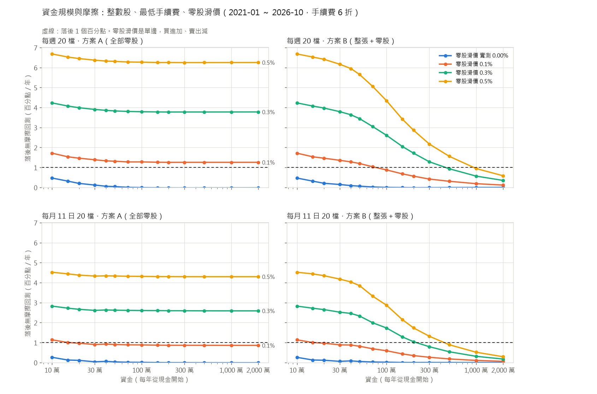

# 用 yfinance 公開資料做台股 LightGBM 排序策略

每週用 LightGBM 對台股做橫斷面排序，挑前 30 名等權重做多；加權指數跌破 120 日均線時降到半倉。
只用公開免費資料（證交所的股票清單與指數、Yahoo Finance 日 K），任何人 clone 下來都能自己重跑、驗證。

**網頁版成果**：<https://neritina-ai.github.io/tw-stock-rank-yfinance/>，先看上線版（每週 20 檔）與基本款對 0050 的表現，最後可以打開持股變化 viewer。

> **AI model declaration** — 本專案的設計、程式與文件由 **Claude Opus 5.5**（Anthropic）透過 Claude Code 完成。

這個 repo 重做[先前另一個 LightGBM 排序研究](https://github.com/neritina-ai/tw-stock-finlab-fable)：那個研究用私有的日 K 資料庫，2018 年以前另外加了基本面與籌碼特徵，
2019 年以後只剩價量。既然最後只用價量，這裡全部改用公開資料從頭寫，資料也從 2000 年開始，比原研究長。
需求的演進記在 [genesis/](genesis/README.md)。
資料下載、股票清單、快取與 `data.lock`、換股日與檔數的掃描、viewer 與疊加圖，沿用同系列
[tw-stock-stable-yfinance](https://github.com/caridina-ai/tw-stock-stable-yfinance)（用對數線性回歸挑「長期穩定上漲」股票）的做法。

## 結論

* **基本款扣成本後，2006-01 ～ 2026-10 年化 +18.2%、Sharpe 1.41**；同期 0050 含息 +15.5%、Sharpe 0.82，
  加權報酬指數（含息）+14.3%、0.79。年化波動 12.4%，只有大盤的三分之二
* **十段 Walk-Forward（每段兩年）每一段 Sharpe 都是正的**，平均 1.53；最弱的是 2010-11（0.45）
* **最大回檔 -44.3%，發生在 2007-07 → 2008-11 的金融海嘯**（0050 同期 -56%）。降半倉擋掉一部分，
  不降半倉會到 -59.6%。2010 年以後最大回檔只有 -15.8%，但 2008 那種行情再來一次，要準備承受四成以上的回檔
* **和先前研究的六段（2014 ～ 2026）對照：Sharpe 平均 1.83 對 1.75**，同一水準。原研究 2018 年以前多了基本面，
  在 2016-17、2018-19 比較好；2019 年以後兩邊方法相同，這裡反而比較好（差異見[驗證](#驗證)）
* 近兩年追不上大盤：2024 ～ 2026 年化 +31.0% 對 0050 的 +55.8%。這段行情集中在台積電等少數權值股，
  等權重 30 檔的組合天生吃不到
* 21 日與 63 日兩個模型的排名平均比單用任何一個好（全期 Sharpe 1.41 對 1.28、1.31）；
  每段只用訓練期重挑參數（續抱倍數、平滑、檔數）得到 1.36，和固定的基本款差不多，基本款的參數不是挑出來的運氣
* **換股頻率與檔數（[詳見下面](#每週換股還是每月換股)）：建議每週換股、20 檔**（Sharpe 1.50、最大回檔 -37.4%）。
  每月換股在每一種檔數都比每週差一點，但不多：每月 11 日、20 檔 Sharpe 1.40，和每週 30 檔的基本款相當，成本少三分之一。
  每月幾日換股主要是運氣；7 檔以下就明顯變差
* **上線前（[詳見下面](#上線前資金零股交割與紙上交易)）：換成真的股數，10 萬元起每年只比無摩擦回測少不到 1 個百分點**
  （每週 20 檔、手續費 6 折，2021 以後：10 萬少 0.5、30 萬少 0.1）。關鍵是零股成交價：實測零股約有 0.2% 的溢價，一買一賣大致抵銷；
  但單邊每多 0.1% 的滑價，全部用零股每年就多少 1.3 個百分點，所以建議能買整張就買整張、餘數零股。交割戶多留淨值的 5%。
  `twrank update`、`plan`、`paper` 可以每週手動跑紙上交易

| 實驗 | 年化報酬 | Sharpe | 最大回檔 | 年化波動 | 年週轉 | 年成本 | 平均曝險 |
|---|---|---|---|---|---|---|---|
| **基本款**（每週 30 檔） | **+18.2%** | **1.41** | -44.3% | 12.4% | 9.5× | 2.79% | 86% |
| 每段挑參數 | +17.6% | 1.36 | -42.0% | 12.5% | 8.1× | 2.37% | 86% |
| 只用 21 日模型 | +17.6% | 1.28 | -44.5% | 13.4% | 11.0× | 3.20% | 86% |
| 只用 63 日模型 | +16.9% | 1.31 | -38.5% | 12.5% | 10.1× | 2.94% | 86% |
| 不降半倉 | +20.9% | 1.21 | -59.6% | 16.8% | 9.2× | 2.67% | 100% |
| **每週 20 檔**（建議） | **+19.9%** | **1.50** | -37.4% | 12.7% | 11.0× | 3.20% | 86% |
| 每月 11 日 20 檔 | +18.2% | 1.40 | -41.9% | 12.5% | 6.9× | 2.02% | 86% |
| 每月 11 日 30 檔 | +17.6% | 1.37 | -42.9% | 12.4% | 6.0× | 1.76% | 86% |
| 每週 8 檔 | +19.8% | 1.41 | -33.4% | 13.5% | 14.1× | 4.12% | 86% |
| 0050 含息 | +15.5% | 0.82 | -56.0% | 20.1% | | | |
| 加權報酬指數（含息） | +14.3% | 0.79 | -56.0% | 19.2% | | | |
| 加權指數（不含息） | +10.1% | 0.60 | -58.3% | 19.2% | | | |

期間 2006-01-02 ～ 2026-10-30（20.2 年），報酬都已扣交易成本。年週轉是一年買進加賣出的金額除以淨值。
完整的表（各段、逐年、各實驗）在 [results/report.md](results/report.md)。


## 觀察持股變化

### 網頁 viewer

線上看：<https://neritina-ai.github.io/tw-stock-rank-yfinance/viewer/>（程式在 [`docs/viewer/`](docs/viewer/index.html)；本機見[怎麼重跑](#怎麼重跑)）。
上一層的 [`docs/index.html`](docs/index.html) 是成果介紹頁，數字與曲線直接讀 viewer 的資料；上線用的設定（每週 20 檔）在 viewer 的分頁上標有「上線」

* **左邊排行榜**：每次換股時分數前 50 名，加上排名外但還在續抱、或這次被汰除的股票；分數是排名百分位（100 = 最好）。
  持股依連續持有多久由黃轉紅，被剔除的依剔除多久由深綠漸淡（一年後不再上色）。持有與剔除的時間一律以週計（兩個換股日相隔幾個日曆週）。
  本次汰除的那一格寫成「買價→賣價 含息報酬」，例如 `19.9→19.9 -0.3%`：買賣價是當天實際的開盤成交價（未還原），
  報酬用還原股價算、含配息配股、未扣成本；滑鼠停在格子上或選到那一列，會顯示買賣日期與持有週數。賣出日沒有成交（停牌或無量）時寫「未成交」
* **右邊 K 線**：還原股價，全範圍時 X 軸是全部日期，Y 軸依畫面內的價格自動調整（`L` 切換對數）。
  紫線是這檔股票**每一次**換股日的分數（不只上榜那幾次），畫在右邊另一個 Y 軸上，範圍固定為該實驗所有上過榜的股票，切換個股時不變。
  藍底是這次排名用到的回推範圍（最長的特徵視窗 252 個交易日），黃底是到下次換股為止的區間，底部紅色色帶是持有期間
* **鍵盤**：`←` `→` 換股日、`↑` `↓` 個股、`Home` `End` 第一次／最後一次換股、`Enter` 放大到「回推起點 → 下次換股」（放大時 `←` `→` 一樣跟著換股日走）、數字鍵切換實驗
* **手機與平板**：畫面最下面有一排按鈕代替鍵盤：第一次／上一次換股、上一檔、放大、下一檔、下一次換股／最後一次換股，以及對數切換
* **實驗成果區**：主要數字、權益曲線與回檔子圖，都和 0050 含息同圖比較（0050 的回檔用虛線），點權益曲線可以跳到那次換股
* 所有結果事先算好放在 `docs/viewer/data/`；個股資料分檔，點到才載入。網址會記住實驗、日期、個股與放大狀態

### 疊加型 Equity Curve

每個實驗一張 `results/exp/<實驗>/stacked.png`。總權益由各持股的市值疊成，一檔一色，連續持有時色塊相連；上圖是金額、下圖是占比，淺灰是現金。


讓同一檔股票的色塊儘量相連的做法：

* **分層**：一檔股票連續持有的期間占同一層；它被汰除時，新進的股票接手那一層。等權重下新股和舊股市值相近，上面各層幾乎不動
* **排序**：換手最少的層放在最下面，再用局部搜尋調整層的順序，讓延續中的色塊在換股時的跳動總和最小
* 也試了「連續愈久畫在愈下面」的直接排法（最長的先放進最低的空層），程式兩種都算、取跳動小的；目前每個實驗都是接手分層勝出
* 降半倉時每一層同時縮成一半、上方出現現金，這是色塊跳動的主要來源（不降半倉的實驗跳動只有基本款的六分之一）

台積電在基本款裡連續持有 171 週（2015-08 ～ 2018-11），是圖中最長的一條色帶。

## 每週換股還是每月換股

需求見 [genesis/FIAT-rebalance.md](genesis/FIAT-rebalance.md)；完整的表與圖在 [results/rebalance/SUMMARY.md](results/rebalance/SUMMARY.md)。

### 實驗怎麼分

都用同一套樣本外分數、同樣的十段 Walk-Forward、同樣的成本，沒提到的設定都和基本款相同：

1. **換股日 × 檔數**：每週，或每月 1 ～ 28 日（遇休市一律順延到下一個交易日），乘上 5、6、7、8、10、12、15、20、25、30 檔，共 290 組
2. **跟著換股頻率一起看的設定**（20 檔）：續抱倍數 2／3／4／6／8 × 分數平滑 1／2／4／8／13 週 × 降半倉的檢查時點（只在換股日／每週／每天）。
   每月的部分 28 個換股日全部都跑、取中位數（共 2,150 組），免得把某一天的運氣當成設定的好壞
3. **誠實版**：每段只用訓練期（2004 年起到該段開始）挑換股日與檔數，原封不動用在測試期，看「事先挑」能拿到多少


（每月的換股日取前後 2 日平均，看的是「附近的選擇是不是都差不多」；未平滑的版本在 [heatmap.png](results/rebalance/heatmap.png)。）

### 結論：每週換股、20 檔

* **每週勝過每月，而且很一致**：同樣檔數下，每週的 Sharpe 都比每月 28 個換股日的中位數高 0.03 ～ 0.22（20 檔：1.50 對 1.37），
  扣掉比較高的成本（每年 3.2% 對 2.0%）之後仍然如此。誠實版也一樣：每段事先挑，每週十段平均 1.50、每月 1.35。每週換股的靈敏度是有用的
* **檔數的高原是每週 12 ～ 20 檔、每月 20 ～ 30 檔**；20 檔同時在兩者的高原上。30 檔（基本款）稍微稀釋，最大回檔也比較深（-44% 對 -37%）
* **臨界值約 7 檔**：以「Sharpe 不低於高原的 90%」當作還能用，每週與每月都是 7 檔以上。
  6 檔以下明顯變差：每月 5 檔的 Sharpe 中位數 1.16、最大回檔 -48%，28 個換股日的 10% 分位數只有 0.96。
  8 ～ 10 檔數字還可以，但每週換股時每年成本 4% 左右、個股風險集中，建議至少 10 檔
* **如果一定要每月換股：每月 11 日、20 檔**（Sharpe 1.40、年化 +18.2%，和每週 30 檔的基本款相當，成本只有 2.0%）。
  不過 9 ～ 15 日都差不多，**哪一天好主要是運氣**：28 個換股日的逐年報酬排名幾乎沒有一致性（Kendall's W = 0.045，p = 0.62），
  同一段裡最好和最差的換股日 Sharpe 可以差 1 以上。所以不必執著於 11 日，挑一個方便執行的日子即可，月底（25 ～ 28 日）略差
* **營收公布前後沒有差別**：每月 10 日以前換股和之後換股，平均 Sharpe 1.35 對 1.34（Mann-Whitney p = 0.61）。
  營收公布後幾天的震盪沒有在這個策略上留下可以利用的痕跡
* **其他設定沿用基本款**：續抱倍數 × 平滑的整個面很平坦（每月 1.27 ～ 1.37、每週 1.21 ～ 1.52），基本款的 4 倍／4 週在高處；
  降半倉每週檢查或只在換股日檢查差不多，每天檢查反而變差（頻繁進出，週轉多三到七成）。換成每月換股不需要跟著改這些設定

### 同樣的段落並排

| 段 | 期間 | 每週 30 檔（基本款） | **每週 20 檔** | 每月 11 日 20 檔 | 每月 11 日 30 檔 | 每月 20 檔：28 個換股日的範圍 |
|---|---|---|---|---|---|---|
| 1 | 2006-07 | 1.10 | 1.29 | 0.99 | 1.18 | 0.76 ～ 1.62 |
| 2 | 2008-09 | 0.93 | 0.98 | 0.85 | 0.85 | 0.55 ～ 1.18 |
| 3 | 2010-11 | 0.45 | 0.77 | 0.59 | 0.24 | -0.22 ～ 1.00 |
| 4 | 2012-13 | 1.82 | 1.76 | 2.33 | 2.16 | 1.16 ～ 2.35 |
| 5 | 2014-15 | 1.27 | 1.51 | 0.57 | 1.04 | 0.57 ～ 1.44 |
| 6 | 2016-17 | 2.09 | 2.18 | 1.92 | 1.79 | 1.65 ～ 2.40 |
| 7 | 2018-19 | 1.04 | 1.33 | 1.49 | 1.23 | 0.94 ～ 1.71 |
| 8 | 2020-21 | 2.24 | 2.22 | 1.89 | 1.91 | 1.25 ～ 2.51 |
| 9 | 2022-23 | 2.18 | 2.51 | 2.35 | 2.44 | 1.51 ～ 2.60 |
| 10 | 2024-26 | 2.18 | 1.93 | 2.23 | 2.15 | 1.62 ～ 2.40 |
| 全期 Sharpe | | 1.41 | **1.50** | 1.40 | 1.37 | |
| 全期年化報酬 | | +18.2% | **+19.9%** | +18.2% | +17.6% | |
| 最大回檔 | | -44.3% | -37.4% | -41.9% | -42.9% | |
| 年週轉 | | 9.5× | 11.0× | 6.9× | 6.0× | |
| 年成本 | | 2.79% | 3.20% | 2.02% | 1.76% | |

表中是各段的 Sharpe；各段的報酬、最大回檔與週轉在 [SUMMARY.md](results/rebalance/SUMMARY.md#同樣的-walk-forward-段落並排)。
這四個設定和「每週 8 檔」（接近臨界值的集中組合）都加進了 viewer 的切換器，也各有一張疊加型 equity curve（`results/exp/<實驗>/stacked.png`）。

## 上線前：資金、零股、交割與紙上交易

需求見 [genesis/FIAT-deploy.md](genesis/FIAT-deploy.md)；完整的表與圖在 [results/deploy/SUMMARY.md](results/deploy/SUMMARY.md)。
前面的回測都是「權重」：可以買任意小數股、成本按比例、沒有最低手續費。這一節把每週 20 檔（建議）換成真的股數再回測一次，
順便跑每月 11 日 20 檔對照。資金 10 萬、30 萬、50 萬、100 萬、200 萬、500 萬只是一組規模。

### 結論

* **整數股與最低手續費的摩擦很小**：每週 20 檔、手續費 6 折，10 萬元每年落後無摩擦回測 0.5 個百分點（2021 以後），
  30 萬 0.1 個百分點，50 萬以上幾乎沒有差別。最低手續費（整股 20 元、零股 1 元）只在 10 萬時有感（約 0.6 個百分點）
* **真正的變數是零股的成交價**。策略 2020-10 ～ 2026-10 實際換股的 1,694 筆買賣，對上證交所、櫃買的盤中零股日行情：
  零股當天第一筆成交價，買進平均比整股開盤價貴 0.22%，賣出平均多賣 0.24%。原因是零股本身有溢價
  （收盤時零股最後成交價平均比整股收盤價高 0.21%，三種撮合間隔下都一樣），一買一賣大致抵銷，所以回測用的零股滑價實測取 0
* **依實測，10 萬元起差距就小於 1 個百分點**，全部零股（方案 A）或整張＋零股（方案 B）都一樣。
  但這個結論對零股滑價很敏感：單邊每 0.1%，方案 A 每年多落後約 1.3 個百分點，**而且跟資金大小無關**；
  方案 B 隨資金變大、整張的比例變高而下降，單邊 0.1% 時 100 萬、0.3% 時 500 萬以上才回到 1 個百分點以內
* **建議方案 B（能買整張就買整張，餘數零股）**。量能是全零股的硬限制：資金 100 萬時每檔 5 萬，
  中位數就占當天這檔股票零股成交金額的 14%，八分之一的單超過全天的零股成交；方案 B 每筆零股不到 1,000 股，中位數約 6%。
  資金愈大，方案 A 的單愈會推動零股價格，實測的「滑價 0」也就愈不可靠
* **交割戶多留淨值的 5%**：一般換股日幾乎不用額外的錢，要防的是開盤跌停賣不掉、新股照買（[交割資金](#交割資金帳上要留多少)）
* **每月 11 日換股**週轉少，對零股滑價比較不敏感（單邊 0.1% 時方案 B 15 萬就在 1 個百分點內），但策略本身的報酬比每週低（見上一節）



每週 20 檔、手續費 6 折，2021-01 ～ 2026-10（盤中零股 2020-10-26 才開始）。落後是「無摩擦的年化報酬 − 整數股的年化報酬」，百分點／年：

| 資金 | 方案 | 年化報酬 | Sharpe | 最大回檔 | 落後（零股實測） | 落後（零股滑價 0.1%） | 落後（0.3%） |
|---|---|---|---|---|---|---|---|
| 無摩擦 | | +28.1% | 2.19 | -9.5% | | | |
| 10 萬 | A | +27.7% | 2.18 | -9.4% | 0.5 | 1.7 | 4.2 |
| 10 萬 | B | +27.7% | 2.18 | -9.4% | 0.5 | 1.7 | 4.2 |
| 30 萬 | A | +28.0% | 2.19 | -9.5% | 0.1 | 1.4 | 3.9 |
| 30 萬 | B | +28.0% | 2.18 | -9.5% | 0.1 | 1.4 | 3.8 |
| 50 萬 | A | +28.1% | 2.19 | -9.5% | 0.0 | 1.3 | 3.8 |
| 50 萬 | B | +28.1% | 2.19 | -9.5% | 0.1 | 1.2 | 3.4 |
| 100 萬 | A | +28.1% | 2.19 | -9.5% | 0.0 | 1.3 | 3.8 |
| 100 萬 | B | +28.1% | 2.19 | -9.5% | 0.0 | 0.9 | 2.6 |
| 200 萬 | A | +28.2% | 2.19 | -9.5% | 0.0 | 1.3 | 3.8 |
| 200 萬 | B | +28.1% | 2.19 | -9.5% | 0.0 | 0.6 | 1.7 |
| 500 萬 | A | +28.2% | 2.19 | -9.5% | 0.0 | 1.3 | 3.8 |
| 500 萬 | B | +28.1% | 2.19 | -9.5% | 0.0 | 0.3 | 0.9 |

2021 年以後正好是大漲的幾年，報酬本身不要直接拿來期待；這張表要看的是「落後」幾欄。
不打折、2.8 折、全期（2006 ～ 2026）、每月 11 日換股與差距的拆解都在 [SUMMARY.md](results/deploy/SUMMARY.md)。

### 怎麼量

* **每年從現金開始**：資金會隨報酬長大，二十年下來 10 萬會變成幾百萬，摩擦就看不出來。所以每一年各自從現金開始：
  每年第一個換股日用指定的資金買進策略當時的持股，做到隔年第一個換股日的前一天，各年再串起來算年化、Sharpe、最大回檔。
  一年之內帳戶大約在資金的 0.6 ～ 1.6 倍之間
* **股數**：用前一天收盤價把目標權重換成股數（無條件捨去），隔天開盤成交，買不滿的錢留現金。
  方案 A 全部用零股（每筆 1 ～ 999 股）；方案 B 每筆委託裡 1,000 股的倍數用整張，餘數用零股
* **成交**：整張以開盤價成交（開盤集合競價）；零股以開盤價加減滑價成交。開盤漲停買不到、開盤跌停賣不掉
* **無摩擦回測**：同樣每年從現金開始，但可以買小數股、手續費按比例（同樣的折扣）、沒有最低手續費、沒有滑價
* **股價用當時實際成交的價格**：Yahoo 把配股記成分割，舊的「原始」股價被往前調低（例如鴻海 2005 年初顯示 41 元，實際約 145 元）。
  這裡用 Yahoo 的分割紀錄還原，早期整張的門檻才不會被低估
* 整數股模擬在「小數股、手續費按比例」的設定下，和原本的權重回測逐年差距在 0.05 個百分點以內

### 假設：手續費、證交稅與盤中零股規則

* **手續費**：成交金額 × 0.1425% × 折扣（不打折、6 折、2.8 折三種），每筆委託無條件捨去到元
* **每筆最低手續費：整股 20 元、零股 1 元，這是假設**。法規只訂上限，最低收費由各券商自訂：
  2020-10 盤中零股上路時，有券商把零股的最低降到 1 元，也有券商維持 20 元（[TechNews，2020-10](https://technews.tw/?p=662051)）；
  2026 年的比較文章裡零股最低 1 元已很普遍，但仍看券商與帳戶類型（[Money101，2026](https://www.money101.com.tw/blog/%e7%86%b1%e9%96%80%e5%88%b8%e5%95%86%e6%af%94%e4%b8%80%e6%af%94)）。
  有的券商零股是按每筆「成交」收最低手續費，一筆委託分幾次撮合就收幾次；最低 1 元時影響很小
* **證交稅**：賣出 0.3%，無條件捨去到元
* **盤中零股**（[櫃買中心盤中零股專區](https://www.tpex.org.tw/zh-tw/mainboard/trading/rules/odd-lot.html)，2026-11 查證）：
  2020-10-26 開始。9:00 ～ 13:30 收單，**9:10 第一次撮合**，之後集合競價連續撮合；撮合間隔起初每 3 分鐘，2022-12-19 起每 1 分鐘，
  **2024-12-02 起每 5 秒**。每筆委託 1 ～ 999 股、只能限價當日有效、不能信用交易，未成交的不留到盤後；漲跌幅和整股一樣。
  **2026-12-07 起**改成 8:30 開始收單、**9:00 和整股同步第一次撮合**（[經濟日報，2026-08-20](https://money.udn.com/money/story/5607/9704423)），
  零股和整股是兩個市場，開盤價可能不同

### 交割資金：帳上要留多少

T+2 交割，同一天的買賣軋差，所以每次換股要付的只是「買進 − 賣出 + 手續費 + 證交稅」。每週 20 檔、方案 B、手續費 6 折
（每年從現金建倉的那一次不算，二十年共 856 個換股日）：

* **一般換股日幾乎不用額外的錢**：淨付款的中位數只有淨值的 0.03%，95% 的換股日在 1.7% 以內。
  委託單用前一天收盤價算股數、隔天以開盤價成交，開盤跳空會讓買進多花或少花一點，捨去零股留下的現金通常就夠
* **降半倉時收錢、回補滿倉時付錢，都是自己的錢**：降半倉那天賣掉約一半部位，T+2 收到約淨值的 56%；
  回補那天付出最多約淨值的 55%，用的就是降半倉時收回、一直放在交割戶裡的現金。只要這筆錢沒有挪作他用，就不必另外準備
* **真正要準備的是「賣不掉」**：開盤跌停或停牌賣不掉，新股卻照買，T+2 就短少那檔的市值。20 檔等權重時一檔約淨值的 5%。
  二十年裡一次換股有一檔賣不掉的有 30 次、兩檔的有 5 次（最多短少淨值的 10.6%，2010-03-22）；
  沒有賣不掉的換股日，不足額最多只有淨值的 0.8%

**建議交割戶裡除了策略本身的錢，另外多留淨值的 5%**（約一檔持股）：可以涵蓋所有沒有賣不掉的換股日與「一檔賣不掉」的情況。
遇到兩檔以上賣不掉，當天少買對應的新股，或在 T+1 補足差額；違約交割的後果很重，不要讓交割戶在 T+2 早上不夠扣。
這 5% 放在交割戶裡就好，不要算進策略的資金（`plan --reserve 0.05` 也可以，但會讓部位少 5%，在多頭裡每年少賺約 1 個百分點）。

### 紙上交易：每週怎麼操作

只算訊號、不連券商，也不常駐、不排程：每一步都是自己手動跑一個指令。

| 指令 | 做什麼 |
|---|---|
| `twrank update` | 下載所有股票最近一個多月的日 K（含除權息與分割），疊在研究用的快取上，重建 `data/live/` 裡的面板、特徵與分數（約 6 ～ 7 分鐘，其中下載約 4 分鐘）。研究用的 `data/prices`、`data/derived`、`data.lock` 都不動 |
| `twrank plan --capital 1000000` | 第一次：開一個 100 萬的紙上帳戶（`paper/default/`），之後不必再給資金。輸出下一個交易日的目標持股、股數與委託清單 |
| `twrank plan --date 2026-11-10` | 指定換股日，例如週一休市、改在週二換股（預設是最新資料的下一個平日） |
| `twrank paper --date 2026-11-09` | 換股日收盤、跑過 `update` 之後：整張用當天實際開盤價、零股用當天盤中零股第一筆成交價（證交所、櫃買的免費日資料）記錄假想成交，再估值到最新收盤 |
| `twrank paper` | 平常日：只把帳戶估值到最新收盤（除息入帳、配股與分割調整股數） |

`plan` 的選項：`--ledger 名稱` 可以開好幾個帳戶；新帳戶可以指定 `--exp m11n20`（每月 11 日）、`--scheme A`（全部零股）、
`--discount 0.28`（手續費折扣，預設 6 折）、`--reserve 0.05`（留在帳外的比例）。
不是換股日時 `plan` 會說「不下單」和下一個換股日；只有持股名單、曝險改變，或距上次換股滿 8 週時才會下單，和回測的規則一樣。

模型：研究期間內的重訓點（每 26 週一次，最後一次 2026-10-05）一律用研究快照的特徵表訓練，和回測的模型一模一樣；
之後的新重訓點（下一次約 2027-04）才用新資料訓練。`update` 只重訓需要的模型，存在 `data/live/models/`。

**每週流程**（每週第一個交易日換股）：

1. **週五收盤後**（或週末）：`uv run twrank update`。Yahoo 的當天日 K 大約收盤後 20 分鐘就定了：
   2026-11-06 實測抽樣 18 檔上市櫃股票，13:51 起收盤價全部和證交所、櫃買公布的一致，到 17:30 都沒再變，所以 14:00 以後就可以跑。
   當天晚上 Yahoo 的成交量還含盤中零股，之後才改成只算整股（和歷史資料一樣）；把當天的成交量換成只算整股重算，
   下一個交易日的分數相關 0.9999、20 檔名單完全相同，所以不必等它修正，下次 `update` 會重新下載最近一個多月、自動換成修正後的資料
2. 接著 `uv run twrank plan`：看委託清單 `paper/default/plans/<週一>.csv`
3. **週一開盤前**：整張用市價或漲停價（買）／跌停價（賣）委託，在 9:00 開盤集合競價成交，和回測一樣；
   零股在第一次撮合前用限價委託（2026-12-07 以前是 9:10，之後和整股一樣 9:00；清單附了漲停價與跌停價）。
   週一休市就延到那一週的第一個交易日，用 `plan --date` 指定
4. **週一收盤後**：`uv run twrank update`，再 `uv run twrank paper --date <週一>` 記錄假想成交；之後隨時可以 `twrank paper` 估值。
   `paper` 要用證交所和櫃買的盤中零股日資料：2026-11-06 實測證交所收盤後半小時內就有，櫃買的整股行情 14:30 ～ 15:00 才公布，
   晚上跑最保險（當天 17:30 兩邊都有了）。資料還沒公布時 `paper` 不記帳（記過的帳不能重來），晚一點再跑，或用 `--odd slip` 改用開盤價加減滑價

第一次記帳就碰到零股的風險：2026-11-06 開盤大跌（台積電開盤就跌停）後急拉，9:10 才第一次撮合的零股跟著漲上去，
那天策略要買的 20 檔，零股第一筆成交價平均比整股開盤價高 1.9%（中位數 0.15%）。長期平均買賣大致抵銷，但單一換股日的零股成本
可能遠高於回測的假設；2026-12-07 起盤中零股改成 9:00 第一次撮合，和整股同時，這種落差應該會變小。

每月 11 日換股的帳戶一樣，只是 `plan` 在 11 日（遇休市順延）之前的那個收盤後跑。

帳本目錄：

```
paper/default/
  ledger.json        設定（實驗、方案、手續費折扣、最低手續費）、現金、持股、上次換股日與曝險
  plans/<日期>.csv   委託清單：代號、名稱、買賣、整股／零股、股數（整股另寫張數）、參考價、漲停價、跌停價、約金額、約手續費與證交稅
  plans/<日期>.json  同上，另有完整的目標持股、分數、排名與「為什麼下單」
  fills.csv          每筆假想成交：價格、手續費、證交稅；沒成交的寫原因（開盤漲停／跌停、當天零股沒成交）
  nav.csv            每天的現金、市值、淨值，除權息與配股紀錄
```

## 資料

只用公開免費資料，不用任何私有或付費資料庫。

| 資料 | 來源 | 說明 |
|---|---|---|
| 股票清單 | [證交所 ISIN 服務](https://isin.twse.com.tw/isin/C_public.jsp?strMode=2) | 上市（`.TW`）、上櫃（`.TWO`）普通股（CFI `ESVUFR`），排除 ETF、特別股、存託憑證；1,985 檔 |
| 個股日 K | yfinance（`auto_adjust=False`） | 原始 OHLCV 與 `Adj Close`。以 `Adj Close / Close` 把整根 K 棒換成還原股價；成交金額用原始收盤價 × 股數估 |
| 大盤 | `^TWII` | 加權指數（不含息），用在降半倉的判斷與對照 |
| 基準 | `0050.TW` 的 `Adj Close` | 元大台灣 50，含息報酬 |
| 終止上市清單 | [證交所](https://www.twse.com.tw/zh/listed/suspend-listing.html) | 只用來估計倖存者偏誤 |

Yahoo 的台股日 K 從 2000-01-04 開始；上櫃股票 2008 年以前完全沒有資料，所以 2008 年以前只有上市股票。

**資料清理**（`twrank/data.py`，每檔剔除與修正的筆數記在 `data/derived/cleaning.csv`）：

* 成交量為 0 的 K 棒當作沒有成交。Yahoo 會在休市日（例如 2016-09-27、28 颱風假）和無成交日補上報價
* 單日尖峰：收盤價同時偏離前後兩天 15% 以上、前後兩天彼此又差不到 10% 的 K 棒剔除。這是混進來的別檔價格，例如 2465 與 6225 在 2005-12-22、12-26 同時漲 50% 又跌回
* 超過漲跌停的跳動：相鄰交易日的還原價漲跌超過當時的漲跌停（2015-06 以前 7%，之後 10%，容許 1.5%），多半是 Yahoo 沒還原到的減資、配股或錯價。把超出的部分當成未還原的除權，調整之前的價格，當天的漲跌改成漲跌停。上市前 5 個交易日與停牌超過 5 天後的第一筆不動

**重現性**：`data.lock` 記錄這份結果用的資料快照（檔數、日期範圍、雜湊），`data.manifest.tsv` 記錄每一檔的筆數、起訖日與雜湊。Yahoo 的歷史資料會被修訂（尤其是還原股價），日後重新下載的數字可能略有出入，用雜湊可以確認是不是同一份資料。

## 方法

### 特徵：26 個價量特徵

每個交易日在可交易股票裡轉成百分位（0～1），只用前一個交易日收盤為止的資料：

| 類別 | 特徵 |
|---|---|
| 報酬與動能 | 5、21、63、126 日報酬，12-1 月動能（252 日前到 21 日前） |
| 位置 | 離 52 週高點、低點多遠；與 20／60／120 日均線的距離 |
| 趨勢品質 | 63 日報酬 t 值、上漲日比例（63 日） |
| 風險與分布 | 21、63 日波動，63 日下跌波動，63 日偏態，21 日最大與最小單日報酬，21 日平均日內振幅，對大盤 63 日 beta |
| 流動性 | Amihud 非流動性（21 日），成交金額水準（63 日中位數取對數），近 21 日 ／ 126 日成交金額比，量的變異係數（21 日） |
| 微結構 | 收盤在當日高低間的位置（21 日平均），隔夜跳空（21 日平均） |

**可交易股票**：近 20 日成交金額中位數 > 1,000 萬元，而且近 130 個交易日至少有 100 天有成交（讓特徵算得出來）。

### 標籤與模型

* 標籤：次日開盤買進、第 21 個（或第 63 個）交易日開盤賣出的報酬，轉成當天可交易股票裡的百分位
* 兩個 LightGBM 回歸模型（21 日、63 日），參數照先前的研究：400 棵樹、學習率 0.05、31 葉、每葉至少 200 筆、特徵與樣本各抽 80%、L2 = 1
* **滾動重訓**：2004 年起每 26 週重訓一次，用到當時為止的全部資料（擴張視窗），而且只用標籤已經完全結束的樣本（第 21／63 個交易日的開盤日早於重訓日），所以每一個分數都是嚴格的樣本外（point-in-time）
* 訓練樣本是每週第一個交易日的資料；模型對之後**每一個交易日**打分數，每月換股（見[每週換股還是每月換股](#每週換股還是每月換股)）也能用同一套分數
* **分數**：兩個模型的預測各自在當天轉成排名百分位，再平均

### 組合（基本款）

* **換股日**：每週第一個交易日。用前一個交易日收盤為止的資料算分數，當天開盤成交。星期一休市就順延到下一個交易日，整週休市（例如農曆年）就併到下一週。只順延、不提前：颱風假常在前一天晚上才宣布，提前的規則實盤做不到
* 前 30 名、等權重
* **續抱緩衝**：持股只要還在前 4 × 30 = 120 名就續抱；續抱用的分數取 4 週平滑（20 個交易日的指數移動平均）
* **降半倉**：前一交易日加權指數收盤 ≤ 120 日 EMA 時，總曝險降為 50%
* 只有持股或曝險變動時才下單（等權重重新配置），否則讓權重隨股價漂移，最多 8 週重新配置一次
* **成本**：買進手續費 0.1425%；賣出手續費 0.1425% ＋ 證交稅 0.3%（手續費不打折，偏保守）
* **成交**：以開盤價成交。開盤就漲停的股票買不到、開盤就跌停的賣不掉（保留原部位）；沒有 K 棒的日子不能交易，部位價值不變

## 驗證

### Walk-Forward

* 模型本身就是滾動訓練：每個分數只用到當時已知、標籤已結束的資料，所以整條回測從頭到尾都是樣本外
* 組合從 2006-01 連續跑到 2026-10，切成十段（每段兩年，最後一段 2024-01 ～ 2026-10）分別計算；其中後六段就是先前研究的六段
* `wfv` 實驗再往前一步：每段只用訓練期（2004 年起到該段開始）在續抱 4／8 倍、平滑 4／8 週、30／50 檔的 8 種組合裡挑 Sharpe 最高的，
  原封不動用在測試期。十段裡有八段挑到「續抱 4 倍、平滑 8 週、30 檔」，結果（Sharpe 1.36）和固定的基本款（1.41）差不多

| 段 | 期間 | 年化報酬 | Sharpe | 最大回檔 | 年週轉 | 0050 年化 | 0050 Sharpe | 0050 回檔 |
|---|---|---|---|---|---|---|---|---|
| 1 | 2006-01 ～ 2007-12 | +17.9% | 1.10 | -24.9% | 11.4× | +19.7% | 1.05 | -20.4% |
| 2 | 2008-01 ～ 2009-12 | +18.1% | 0.93 | -35.7% | 11.1× | +2.2% | 0.22 | -53.6% |
| 3 | 2010-01 ～ 2011-12 | +5.3% | 0.45 | -16.7% | 12.9× | -2.4% | -0.03 | -23.0% |
| 4 | 2012-01 ～ 2013-12 | +19.6% | 1.82 | -13.5% | 10.6× | +12.2% | 0.91 | -14.9% |
| 5 | 2014-01 ～ 2015-12 | +10.7% | 1.27 | -10.4% | 7.9× | +4.7% | 0.39 | -21.0% |
| 6 | 2016-01 ～ 2017-12 | +18.0% | 2.09 | -3.9% | 6.8× | +19.7% | 1.48 | -8.6% |
| 7 | 2018-01 ～ 2019-12 | +7.8% | 1.04 | -7.8% | 9.7× | +13.2% | 0.91 | -17.5% |
| 8 | 2020-01 ～ 2021-12 | +31.5% | 2.24 | -15.8% | 9.4× | +27.5% | 1.27 | -28.2% |
| 9 | 2022-01 ～ 2023-12 | +20.2% | 2.18 | -7.0% | 9.7× | +0.1% | 0.10 | -34.0% |
| 10 | 2024-01 ～ 2026-10 | +31.0% | 2.18 | -8.7% | 7.1× | +55.8% | 1.79 | -27.5% |
| 平均 | | | **1.53** | | | | 0.81 | |

平均持股 30 檔（第 2 段跌停賣不掉時會暫時多出幾檔）。2006 ～ 2009 的 0050 欄位是加權報酬指數，見[限制](#限制會讓結果偏樂觀的地方)。

模型的樣本外 rank IC（每次重訓到下次重訓之間，週資料）：21 日模型平均 0.097、63 日模型 0.121，46 次重訓裡 IC 為正的比例 98%／96%。
最常用到的特徵是 63 日波動、12-1 月動能、離 52 週高點的距離與日內振幅（`results/models/importance.csv`）。

### 和先前研究對照

先前研究的數字取自它的 [`research/h63-ensemble.md`](https://github.com/neritina-ai/tw-stock-finlab-fable/blob/h63-ensemble-v1/research/h63-ensemble.md)（all4 組合）。

| 期間 | 本 repo Sharpe | 先前研究 | 本 repo 年化 | 先前研究 | 本 repo 回檔 | 先前研究 | 本 repo 週轉 | 先前研究 |
|---|---|---|---|---|---|---|---|---|
| 2014-15 | 1.27 | 1.30 | +10.7% | +12.2% | -10.4% | -10.6% | 7.9× | 8.1× |
| 2016-17 | 2.09 | 2.54 | +18.0% | +25.9% | -3.9% | -3.7% | 6.8× | 7.2× |
| 2018-19 | 1.04 | 1.30 | +7.8% | +10.4% | -7.8% | -8.3% | 9.7× | 9.2× |
| 2020-21 | 2.24 | 2.10 | +31.5% | +31.9% | -15.8% | -15.4% | 9.4× | 9.5× |
| 2022-23 | 2.18 | 1.79 | +20.2% | +17.5% | -7.0% | -8.8% | 9.7× | 9.0× |
| 2024-26 | 2.18 | 1.46 | +31.0% | +21.1% | -8.7% | -12.2% | 7.1× | 7.0× |
| 平均 | **1.83** | **1.75** | | | | | | |

兩邊的組合規則相同（前 30 名、續抱 4 × 30、4 週平滑、跌破 120 日 EMA 降半倉、同樣的成本），數字不一樣的原因：

* **特徵**：原研究 2018 年以前的分數是四個模型的平均，其中兩個多了 13 個基本面與籌碼特徵（月營收、融資、估值、法人）；
  2019 年以後才和這裡一樣只用價量的 21 日與 63 日模型。前三段（2014 ～ 2019）原研究比較好，主要就是基本面的貢獻
* **資料**：原研究用私有的日 K 資料庫（自行還原權息、應該含已下市公司），資料從 2007 年開始；這裡用 Yahoo（沒有下市公司，見限制），從 2000 年開始，
  所以模型的訓練資料多了七年
* **可交易股票**：原研究是成交金額中位數 > 2,000 萬、股價 > 10 元；這裡照需求用 > 1,000 萬，沒有股價門檻
* **分段方式**：原研究每段從現金重新開始，最後一段到 2026-04-19；這裡是一條連續的組合切段計算，最後一段到 2026-10-30（多了 2026 年下半年的漲勢）
* **平滑**：原研究對每週的分數做 4 週的指數平滑；這裡對每天的分數做 20 個交易日的指數平滑（為了讓每月換股也能用同一個定義）

## 限制：會讓結果偏樂觀的地方

* **倖存者偏誤**（最主要的偏誤）：股票清單是今天還在上市櫃的公司，Yahoo 也沒有已下市公司的股價，所以回測從來不會買到後來下市的股票。
  證交所終止上市清單裡，2006 年起有 156 家普通股下市，平均每年約占上市家數的 0.9%（2006 ～ 2008 年 2 ～ 3%，2012 年以後多半不到 1%）。
  粗估：如果組合買到下市股的機率和全體一樣、每家下市虧掉 50% ～ 100%，每年少 0.5 ～ 0.9 個百分點的報酬，早期更多。
  實際上下市原因有不少是合併或下市收購（不一定虧錢），組合又偏好流動性好、有動能的股票，影響可能比這個小；
  但下市股不在候選名單裡也會改變排名，這部分無法估計。上櫃沒有可以程式下載的終止上櫃清單，沒有納入估計
* **上櫃 2008 年以前缺資料**：Yahoo 的上櫃股票從 2007 年底才有日 K，所以 2006 ～ 2007 只能在上市股票（約 600 檔）裡選股
* **成交假設**：以開盤價成交，只擋掉「開盤就漲停買不到、開盤就跌停賣不掉」；沒有模擬盤中鎖死、滑價、市場衝擊。
  整股與零股的影響另外在[上線前](#上線前資金零股交割與紙上交易)一節用整數股回測估計：零股的成交價只用每日行情的第一筆成交價估，
  沒有逐筆資料，也估不到自己的單對零股價格的衝擊；大資金全用零股時這個假設最不可靠
* **Yahoo 的資料品質**：清理規則（零成交量、尖峰、超過漲跌停的跳動）是啟發式的；被夾住的跳動當天的真實漲跌不得而知，用漲跌停幅度代替。
  Yahoo 的歷史還原價日後也可能被修訂
* **基準**：證交所的 0050 日資料從 2010 年開始，Yahoo 的 0050 又有錯，所以 2006 ～ 2009 的「0050 含息」用加權報酬指數代替（兩者都是含息的大型股報酬，走勢相近）
* **參數不是在這裡挑的**：基本款的組合參數與 LightGBM 參數沿用先前研究，而那些參數是用 2008 年以後的資料挑的，對前幾段算是看過答案。
  `wfv` 實驗只用每段訓練期重挑組合參數，結果差不多，但 LightGBM 參數沒有重挑

## 怎麼重跑

需要 [uv](https://docs.astral.sh/uv/) 與 Python 3.13 以上。

```bash
git clone https://github.com/neritina-ai/tw-stock-rank-yfinance.git
cd tw-stock-rank-yfinance
uv sync

uv run twrank fetch      # 下載股票清單與日 K（可續傳，約 15 分鐘），清理後建面板與 data.lock
uv run twrank all        # 特徵 → 滾動訓練 → 回測 → 每段挑參數 → 換股頻率掃描 → 疊加圖 → viewer → 報告
```

`twrank all` 也可以拆開一步一步跑：

| 指令 | 做什麼 | 輸出 |
|---|---|---|
| `twrank features` | 26 個特徵與兩個標籤（約 1 分鐘） | `data/derived/table.parquet` |
| `twrank train` | 46 次滾動重訓 × 2 個模型（CPU 約 15 分鐘） | `data/derived/scores.parquet`、`results/models/` |
| `twrank run [--only ID ...]` | 回測各實驗 | `results/exp/<實驗>/` |
| `twrank wfv` | 每段只用訓練期挑參數 | `results/exp/wfv/` |
| `twrank rebalance` | 換股日 × 檔數、設定、誠實版的掃描（約 15 分鐘，多核心） | `results/rebalance/*.csv` |
| `twrank rebalance-report` | 熱力圖、檢定與結論 | `results/rebalance/SUMMARY.md`、`*.png` |
| `twrank stacked` | 疊加型 equity curve | `results/exp/<實驗>/stacked.png` |
| `twrank viewer` | 網頁 viewer 的資料 | `docs/viewer/` |
| `twrank report` | 結果表與權益曲線圖 | `results/report.md`、`results/equity.png` |
| `twrank odd-lot` | 抓換股日的盤中零股與整股行情（約 1.5 小時，可續傳）、持股的分割紀錄，估零股成交落差 | `data/odd/`、`results/deploy/oddlot.json` |
| `twrank deploy` | 資金 × 方案 × 成本的整數股回測、差距拆解、交割資金（約 2 分鐘，多核心） | `results/deploy/*.csv` |
| `twrank deploy-report` | 上線前的結論表與圖 | `results/deploy/SUMMARY.md`、`gap.png` |

最後三個是上線前的分析，不在 `twrank all` 裡（`odd-lot` 要從證交所、櫃買下載一個多小時），依序另外跑。
紙上交易的 `update`、`plan`、`paper` 見[紙上交易：每週怎麼操作](#紙上交易每週怎麼操作)；它們只寫 `data/live/` 與 `paper/`，不動上面的研究結果。

本機看 viewer：`python -m http.server -d docs` 後開 <http://localhost:8000/viewer/>。

pip 安裝的 LightGBM 在 Windows 沒有 GPU 版，預設用 CPU（`deterministic=True`，同一份資料重跑結果相同）；自行編譯 GPU 版的話可以加 `--device gpu`。

`data/` 與 `paper/` 不進版本控制（下載的資料與中間檔，可以用上面的指令重建；紙上帳本是自己的）；`results/` 與 `docs/` 的結果都在版本控制裡，只有掃描的逐日報酬矩陣（`results/rebalance/*_returns.parquet`）與每個換股日的交割現金流（`results/deploy/settlement.csv`）太大不放，用 `twrank rebalance`、`twrank deploy` 重建。

## 專案結構

```
src/twrank/
  universe.py      證交所 ISIN 股票清單、終止上市清單
  data.py          yfinance 下載（節流、可續傳、失敗重試）、清理、寬表、data.lock
  features.py      交易日曆、可交易股票、26 個特徵、標籤
  train.py         滾動 LightGBM，逐日樣本外分數
  portfolio.py     分數、換股日、續抱緩衝、降半倉 → 目標權重
  backtest.py      逐日回測（開盤成交、成本、漲跌停買賣不到）
  metrics.py       年化報酬、Sharpe、最大回檔、週轉…
  experiments.py   實驗清單、Walk-Forward 分段、每段挑參數、結果檔
  stacked.py       疊加型 equity curve
  viewer_build.py  匯出 viewer 資料
  report.py        結果表
  rebalance.py     每週／每月換股的掃描與加進 viewer 的實驗
  rebalance_report.py  熱力圖、換股日一致性檢定、SUMMARY.md
  oddlot.py        證交所／櫃買的盤中零股日行情與整股開盤價（下載、快取）
  lots.py          整數股回測：股數、整張／零股、最低手續費、零股滑價、交割現金
  deploy.py        資金 × 方案 × 成本的掃描、差距拆解、交割資金、零股實測
  deploy_report.py results/deploy/SUMMARY.md 與圖
  live.py          紙上交易：近期資料更新、即時分數、plan、paper、帳本
  templates/viewer.html
tests/             單元測試（uv run pytest）
genesis/           需求檔
```

本專案為研究與教學用途，**不構成投資建議**。
