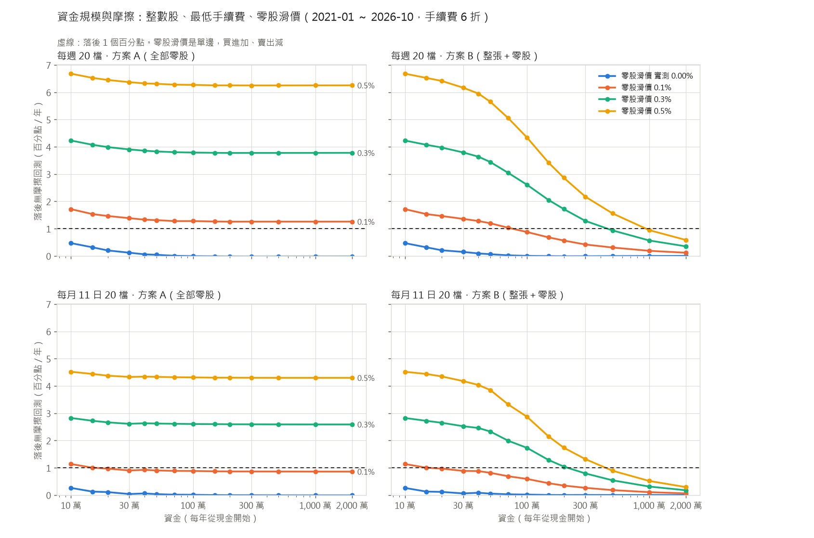

# 上線前：資金、零股、成本與交割資金

需求見 [genesis/FIAT-deploy.md](../../genesis/FIAT-deploy.md)。由 `twrank odd-lot`、`twrank deploy`、`twrank deploy-report` 產生。

## 怎麼量

* **每年從現金開始**：每年第一個換股日，帳戶以指定的資金從現金開始，買進策略當時的持股，一直做到隔年第一個換股日的前一天；各年的報酬再串起來算年化、Sharpe、最大回檔。這樣每個資金規模都維持在那個規模附近（一年內大約 0.6 ～ 1.6 倍），不會因為複利長大而看不出摩擦
* **持股是整數股**：用前一天收盤價把目標權重換成股數（無條件捨去），隔天開盤成交，買不滿的錢留現金。方案 A 全部用零股（每筆 1 ～ 999 股）；方案 B 每筆委託裡 1,000 股的倍數用整張，餘數用零股
* **成本**：手續費 0.1425% × 折扣，每筆最低整股 20 元、零股 1 元（假設，見 README），賣出證交稅 0.3%，都按每筆委託無條件捨去到元
* **成交**：整張以開盤價成交；零股以開盤價加減滑價成交（買進加、賣出減）。開盤漲停買不到、開盤跌停賣不掉
* **無摩擦回測**：同樣的每年重來，但可以買小數股、手續費按比例（同樣的折扣）、沒有最低手續費、沒有滑價。差距 = 無摩擦的年化報酬 − 整數股的年化報酬
* 股價用實際成交的價格：Yahoo 把配股記成分割，舊的「原始」股價被往前調低（例如鴻海 2005 年初顯示 41 元，實際約 145 元），這裡用 Yahoo 的分割紀錄還原，整張的門檻才不會被低估
* 盤中零股 2020-10-26 才開始，**下面主要看 2021 年以後**（2021-01 ～ 2026-10），全期（2006 ～ 2026）列在旁邊參考

## 盤中零股的成交價與量能

策略在 2020-10-26 ～ 2026-10 實際換股的日子，每一筆買進（新增）與賣出（剔除），對上證交所與櫃買中心當天的盤中零股日行情與整股開盤價，共 1,694 筆（另有 8 筆當天零股沒有成交）。「成本」是對策略不利的方向：買進時零股價高於整股開盤價、賣出時低於開盤價為正。

|  | 筆數 | 第一筆成交價：平均 | 中位數 | 10%～90% 分位 | 全日均價：平均 | 中位數  |
|---|---|---|---|---|---|---|
| 買進 | 848 | +0.22% | +0.12% | -0.84% ～ +1.24% | +0.06% | +0.02% |
| 賣出 | 846 | -0.24% | -0.18% | -1.27% ～ +0.78% | -0.07% | -0.07% |
| 合計 | 1,694 | -0.02% | +0.00% | -1.03% ～ +0.99% | -0.01% | -0.02% |

（平均去掉兩端各 1% 的極端值。第一筆成交價是當天第一次撮合的價格，盤中零股 9:10 才第一次撮合。）

| 撮合間隔 | 筆數 | 第一筆成本：平均 | 中位數 |
|---|---|---|---|
| 3 分鐘 | 706 | +0.01% | +0.00% |
| 1 分鐘 | 482 | -0.06% | +0.00% |
| 5 秒 | 506 | -0.01% | +0.00% |

**回測用的零股滑價取 0.00%**：現行每 5 秒撮合以來，第一筆成交價對整股開盤價的平均成本（買賣合計）。另外用單邊 0.1%、0.3%、0.5% 做敏感度。零股收盤時的買賣價差中位數 0.30%。

量能：一檔新買進的單（資金 ÷ 20）占當天這檔股票盤中零股成交金額的比例。

| 資金 | 每檔約 | A：占當天零股成交金額（中位數） | A：超過 25% 的比例 | A：超過全天成交的比例 | B：中位數 | B：超過 25% |
|---|---|---|---|---|---|---|
| 10 萬 | 5,000 | 1.4% | 5% | 2% | 1.4% | 5% |
| 30 萬 | 15,000 | 4.3% | 14% | 4% | 4.0% | 14% |
| 50 萬 | 25,000 | 7.1% | 23% | 6% | 5.7% | 19% |
| 100 萬 | 50,000 | 14.3% | 38% | 12% | 5.8% | 21% |
| 200 萬 | 100,000 | 28.6% | 53% | 23% | 5.2% | 20% |
| 500 萬 | 250,000 | 71.4% | 69% | 42% | 6.4% | 20% |

## 每週 20 檔：資金 × 方案 × 手續費折扣

零股滑價 0.00%（實測）。年化報酬、Sharpe、最大回檔是 2021-01 ～ 2026-10；差距是落後無摩擦回測的百分點（每年），括號內是全期 2006 ～ 2026。

| 折扣 | 資金 | 方案 | 年化 | Sharpe | 最大回檔 | 差距 | 全期年化 |
|---|---|---|---|---|---|---|---|
| 不打折 | 無摩擦 |  | 27.4% | 2.14 | -9.8% |  | 19.7% |
| 不打折 | 10 萬 | A | 27.0% | 2.13 | -9.7% | 0.4（0.3） | 19.4% |
| 不打折 | 10 萬 | B | 27.0% | 2.13 | -9.7% | 0.4（0.3） | 19.4% |
| 不打折 | 30 萬 | A | 27.3% | 2.14 | -9.7% | 0.1（0.0） | 19.6% |
| 不打折 | 30 萬 | B | 27.3% | 2.14 | -9.7% | 0.1（0.1） | 19.6% |
| 不打折 | 50 萬 | A | 27.4% | 2.14 | -9.7% | 0.0（0.0） | 19.7% |
| 不打折 | 50 萬 | B | 27.4% | 2.14 | -9.7% | 0.0（0.0） | 19.7% |
| 不打折 | 100 萬 | A | 27.4% | 2.14 | -9.8% | 0.0（-0.1） | 19.7% |
| 不打折 | 100 萬 | B | 27.4% | 2.14 | -9.8% | 0.0（0.0） | 19.7% |
| 不打折 | 200 萬 | A | 27.4% | 2.14 | -9.8% | 0.0（0.0） | 19.7% |
| 不打折 | 200 萬 | B | 27.4% | 2.14 | -9.8% | 0.0（0.0） | 19.7% |
| 不打折 | 500 萬 | A | 27.4% | 2.14 | -9.8% | 0.0（0.0） | 19.7% |
| 不打折 | 500 萬 | B | 27.4% | 2.14 | -9.8% | 0.0（0.0） | 19.7% |
| 6 折 | 無摩擦 |  | 28.1% | 2.19 | -9.5% |  | 20.5% |
| 6 折 | 10 萬 | A | 27.7% | 2.18 | -9.4% | 0.5（0.4） | 20.1% |
| 6 折 | 10 萬 | B | 27.7% | 2.18 | -9.4% | 0.5（0.4） | 20.1% |
| 6 折 | 30 萬 | A | 28.0% | 2.19 | -9.5% | 0.1（0.1） | 20.4% |
| 6 折 | 30 萬 | B | 28.0% | 2.18 | -9.5% | 0.1（0.1） | 20.3% |
| 6 折 | 50 萬 | A | 28.1% | 2.19 | -9.5% | 0.0（0.0） | 20.4% |
| 6 折 | 50 萬 | B | 28.1% | 2.19 | -9.5% | 0.1（0.1） | 20.4% |
| 6 折 | 100 萬 | A | 28.1% | 2.19 | -9.5% | 0.0（0.0） | 20.5% |
| 6 折 | 100 萬 | B | 28.1% | 2.19 | -9.5% | 0.0（0.0） | 20.4% |
| 6 折 | 200 萬 | A | 28.2% | 2.19 | -9.5% | 0.0（0.0） | 20.5% |
| 6 折 | 200 萬 | B | 28.1% | 2.19 | -9.5% | 0.0（0.0） | 20.5% |
| 6 折 | 500 萬 | A | 28.2% | 2.19 | -9.5% | 0.0（0.0） | 20.5% |
| 6 折 | 500 萬 | B | 28.1% | 2.19 | -9.5% | 0.0（0.0） | 20.5% |
| 2.8 折 | 無摩擦 |  | 28.7% | 2.23 | -9.4% |  | 21.1% |
| 2.8 折 | 10 萬 | A | 28.2% | 2.21 | -9.2% | 0.5（0.5） | 20.6% |
| 2.8 折 | 10 萬 | B | 28.2% | 2.21 | -9.2% | 0.5（0.5） | 20.6% |
| 2.8 折 | 30 萬 | A | 28.6% | 2.22 | -9.4% | 0.2（0.1） | 21.0% |
| 2.8 折 | 30 萬 | B | 28.5% | 2.22 | -9.4% | 0.2（0.2） | 20.9% |
| 2.8 折 | 50 萬 | A | 28.6% | 2.23 | -9.4% | 0.1（0.0） | 21.0% |
| 2.8 折 | 50 萬 | B | 28.6% | 2.22 | -9.4% | 0.2（0.2） | 20.9% |
| 2.8 折 | 100 萬 | A | 28.7% | 2.23 | -9.4% | 0.0（0.0） | 21.1% |
| 2.8 折 | 100 萬 | B | 28.6% | 2.22 | -9.4% | 0.1（0.1） | 21.0% |
| 2.8 折 | 200 萬 | A | 28.7% | 2.23 | -9.4% | 0.0（0.0） | 21.1% |
| 2.8 折 | 200 萬 | B | 28.7% | 2.23 | -9.4% | 0.0（0.0） | 21.1% |
| 2.8 折 | 500 萬 | A | 28.7% | 2.23 | -9.4% | 0.0（0.0） | 21.1% |
| 2.8 折 | 500 萬 | B | 28.7% | 2.23 | -9.4% | 0.0（0.0） | 21.1% |

## 每月 11 日 20 檔：資金 × 方案 × 手續費折扣

零股滑價 0.00%（實測）。年化報酬、Sharpe、最大回檔是 2021-01 ～ 2026-10；差距是落後無摩擦回測的百分點（每年），括號內是全期 2006 ～ 2026。

| 折扣 | 資金 | 方案 | 年化 | Sharpe | 最大回檔 | 差距 | 全期年化 |
|---|---|---|---|---|---|---|---|
| 不打折 | 無摩擦 |  | 29.5% | 2.25 | -10.8% |  | 18.1% |
| 不打折 | 10 萬 | A | 29.3% | 2.26 | -10.6% | 0.2（0.0） | 18.1% |
| 不打折 | 10 萬 | B | 29.3% | 2.26 | -10.6% | 0.2（0.0） | 18.1% |
| 不打折 | 30 萬 | A | 29.5% | 2.26 | -10.7% | 0.0（0.0） | 18.2% |
| 不打折 | 30 萬 | B | 29.5% | 2.26 | -10.7% | 0.0（0.0） | 18.1% |
| 不打折 | 50 萬 | A | 29.5% | 2.26 | -10.7% | 0.0（0.0） | 18.2% |
| 不打折 | 50 萬 | B | 29.5% | 2.26 | -10.7% | 0.0（0.0） | 18.1% |
| 不打折 | 100 萬 | A | 29.5% | 2.25 | -10.8% | 0.0（0.0） | 18.2% |
| 不打折 | 100 萬 | B | 29.5% | 2.25 | -10.8% | 0.0（0.0） | 18.2% |
| 不打折 | 200 萬 | A | 29.6% | 2.25 | -10.8% | 0.0（0.0） | 18.2% |
| 不打折 | 200 萬 | B | 29.6% | 2.25 | -10.8% | 0.0（0.0） | 18.2% |
| 不打折 | 500 萬 | A | 29.6% | 2.25 | -10.8% | 0.0（0.0） | 18.2% |
| 不打折 | 500 萬 | B | 29.5% | 2.25 | -10.8% | 0.0（0.0） | 18.1% |
| 6 折 | 無摩擦 |  | 30.0% | 2.29 | -10.5% |  | 18.6% |
| 6 折 | 10 萬 | A | 29.8% | 2.30 | -10.3% | 0.3（0.1） | 18.6% |
| 6 折 | 10 萬 | B | 29.8% | 2.30 | -10.3% | 0.3（0.1） | 18.6% |
| 6 折 | 30 萬 | A | 30.0% | 2.29 | -10.4% | 0.0（0.0） | 18.6% |
| 6 折 | 30 萬 | B | 30.0% | 2.29 | -10.4% | 0.1（0.0） | 18.6% |
| 6 折 | 50 萬 | A | 30.0% | 2.29 | -10.5% | 0.0（0.0） | 18.6% |
| 6 折 | 50 萬 | B | 30.0% | 2.29 | -10.5% | 0.1（0.0） | 18.6% |
| 6 折 | 100 萬 | A | 30.0% | 2.29 | -10.5% | 0.0（0.0） | 18.7% |
| 6 折 | 100 萬 | B | 30.0% | 2.29 | -10.5% | 0.0（0.0） | 18.6% |
| 6 折 | 200 萬 | A | 30.1% | 2.29 | -10.5% | 0.0（0.0） | 18.7% |
| 6 折 | 200 萬 | B | 30.0% | 2.29 | -10.5% | 0.0（0.0） | 18.6% |
| 6 折 | 500 萬 | A | 30.1% | 2.29 | -10.5% | 0.0（0.0） | 18.7% |
| 6 折 | 500 萬 | B | 30.0% | 2.29 | -10.5% | 0.0（0.0） | 18.6% |
| 2.8 折 | 無摩擦 |  | 30.4% | 2.31 | -10.3% |  | 19.0% |
| 2.8 折 | 10 萬 | A | 30.2% | 2.32 | -10.0% | 0.3（0.1） | 18.9% |
| 2.8 折 | 10 萬 | B | 30.2% | 2.32 | -10.0% | 0.3（0.1） | 18.9% |
| 2.8 折 | 30 萬 | A | 30.4% | 2.32 | -10.2% | 0.1（0.0） | 19.0% |
| 2.8 折 | 30 萬 | B | 30.3% | 2.31 | -10.2% | 0.1（0.1） | 18.9% |
| 2.8 折 | 50 萬 | A | 30.4% | 2.31 | -10.2% | 0.0（0.0） | 19.0% |
| 2.8 折 | 50 萬 | B | 30.3% | 2.31 | -10.3% | 0.1（0.1） | 18.9% |
| 2.8 折 | 100 萬 | A | 30.4% | 2.31 | -10.2% | 0.0（0.0） | 19.0% |
| 2.8 折 | 100 萬 | B | 30.4% | 2.31 | -10.3% | 0.1（0.1） | 19.0% |
| 2.8 折 | 200 萬 | A | 30.5% | 2.31 | -10.2% | 0.0（0.0） | 19.0% |
| 2.8 折 | 200 萬 | B | 30.4% | 2.31 | -10.2% | 0.0（0.0） | 19.0% |
| 2.8 折 | 500 萬 | A | 30.5% | 2.31 | -10.2% | 0.0（0.0） | 19.1% |
| 2.8 折 | 500 萬 | B | 30.4% | 2.31 | -10.3% | 0.0（0.0） | 19.0% |

## 差距從哪裡來（手續費 6 折）

依序加上去：只有整數股（捨去的零頭留現金，手續費按比例、沒有最低）→ 加上最低手續費 → 加上零股滑價 0.1%（實測約 0.00%，這裡用 0.1% 示範滑價的份量）。百分點／年，2021 以後（括號內全期）。整數股這一步常是負的：手續費與證交稅按每筆無條件捨去到元，小單省下的零頭比捨去股數留下的現金拖累還多。

| 實驗 | 方案 | 資金 | 整數股 | 最低手續費 | 零股滑價 0.1% | 合計 |
|---|---|---|---|---|---|---|
| 每週 20 檔 | A | 10 萬 | -0.1（-0.2） | 0.6（0.6） | 1.2（1.4） | 1.7（1.7） |
| 每週 20 檔 | A | 30 萬 | -0.1（-0.1） | 0.2（0.2） | 1.3（1.4） | 1.4（1.5） |
| 每週 20 檔 | A | 50 萬 | -0.1（-0.1） | 0.1（0.1） | 1.3（1.4） | 1.3（1.4） |
| 每週 20 檔 | A | 100 萬 | -0.1（-0.1） | 0.0（0.0） | 1.3（1.4） | 1.3（1.4） |
| 每週 20 檔 | A | 200 萬 | 0.0（-0.1） | 0.0（0.0） | 1.3（1.4） | 1.3（1.4） |
| 每週 20 檔 | A | 500 萬 | 0.0（0.0） | 0.0（0.0） | 1.3（1.4） | 1.3（1.4） |
| 每週 20 檔 | B | 10 萬 | -0.1（-0.2） | 0.6（0.6） | 1.2（1.4） | 1.7（1.7） |
| 每週 20 檔 | B | 30 萬 | -0.1（-0.1） | 0.2（0.3） | 1.2（1.3） | 1.4（1.4） |
| 每週 20 檔 | B | 50 萬 | -0.1（-0.1） | 0.1（0.2） | 1.1（1.1） | 1.2（1.2） |
| 每週 20 檔 | B | 100 萬 | -0.1（-0.1） | 0.1（0.1） | 0.9（0.8） | 0.9（0.8） |
| 每週 20 檔 | B | 200 萬 | 0.0（0.0） | 0.0（0.0） | 0.6（0.5） | 0.6（0.5） |
| 每週 20 檔 | B | 500 萬 | 0.0（0.0） | 0.0（0.0） | 0.3（0.3） | 0.3（0.3） |
| 每月 11 日 20 檔 | A | 10 萬 | 0.1（0.0） | 0.1（0.1） | 0.9（0.9） | 1.1（0.9） |
| 每月 11 日 20 檔 | A | 30 萬 | 0.0（0.0） | 0.0（0.0） | 0.9（0.9） | 0.9（0.8） |
| 每月 11 日 20 檔 | A | 50 萬 | 0.0（0.0） | 0.0（0.0） | 0.9（0.9） | 0.9（0.9） |
| 每月 11 日 20 檔 | A | 100 萬 | 0.0（0.0） | 0.0（0.0） | 0.9（0.9） | 0.9（0.8） |
| 每月 11 日 20 檔 | A | 200 萬 | 0.0（0.0） | 0.0（0.0） | 0.9（0.9） | 0.9（0.8） |
| 每月 11 日 20 檔 | A | 500 萬 | 0.0（0.0） | 0.0（0.0） | 0.9（0.9） | 0.9（0.8） |
| 每月 11 日 20 檔 | B | 10 萬 | 0.1（0.0） | 0.1（0.1） | 0.9（0.9） | 1.1（0.9） |
| 每月 11 日 20 檔 | B | 30 萬 | 0.0（0.0） | 0.1（0.1） | 0.8（0.8） | 0.9（0.8） |
| 每月 11 日 20 檔 | B | 50 萬 | 0.0（0.0） | 0.0（0.1） | 0.8（0.7） | 0.8（0.7） |
| 每月 11 日 20 檔 | B | 100 萬 | 0.0（0.0） | 0.0（0.0） | 0.6（0.5） | 0.6（0.5） |
| 每月 11 日 20 檔 | B | 200 萬 | 0.0（0.0） | 0.0（0.0） | 0.3（0.3） | 0.3（0.3） |
| 每月 11 日 20 檔 | B | 500 萬 | 0.0（0.0） | 0.0（0.0） | 0.2（0.1） | 0.2（0.1） |

## 零股滑價的敏感度（手續費 6 折）

差距（百分點／年，2021 以後；括號內全期）。

| 實驗 | 方案 | 資金 | 0.00%（實測） | 0.10% | 0.30% | 0.50% |
|---|---|---|---|---|---|---|
| 每週 20 檔 | A | 10 萬 | 0.5（0.4） | 1.7（1.7） | 4.2（4.5） | 6.7（7.1） |
| 每週 20 檔 | A | 30 萬 | 0.1（0.1） | 1.4（1.5） | 3.9（4.2） | 6.4（6.9） |
| 每週 20 檔 | A | 50 萬 | 0.0（0.0） | 1.3（1.4） | 3.8（4.1） | 6.3（6.8） |
| 每週 20 檔 | A | 100 萬 | 0.0（0.0） | 1.3（1.4） | 3.8（4.1） | 6.3（6.8） |
| 每週 20 檔 | A | 200 萬 | 0.0（0.0） | 1.3（1.4） | 3.8（4.1） | 6.3（6.8） |
| 每週 20 檔 | A | 500 萬 | 0.0（0.0） | 1.3（1.4） | 3.8（4.1） | 6.2（6.8） |
| 每週 20 檔 | B | 10 萬 | 0.5（0.4） | 1.7（1.7） | 4.2（4.5） | 6.7（7.1） |
| 每週 20 檔 | B | 30 萬 | 0.1（0.1） | 1.4（1.4） | 3.8（4.0） | 6.2（6.5） |
| 每週 20 檔 | B | 50 萬 | 0.1（0.1） | 1.2（1.2） | 3.4（3.5） | 5.7（5.7） |
| 每週 20 檔 | B | 100 萬 | 0.0（0.0） | 0.9（0.8） | 2.6（2.4） | 4.3（4.1） |
| 每週 20 檔 | B | 200 萬 | 0.0（0.0） | 0.6（0.5） | 1.7（1.5） | 2.9（2.6） |
| 每週 20 檔 | B | 500 萬 | 0.0（0.0） | 0.3（0.3） | 0.9（0.8） | 1.6（1.4） |
| 每月 11 日 20 檔 | A | 10 萬 | 0.3（0.1） | 1.1（0.9） | 2.8（2.6） | 4.5（4.3） |
| 每月 11 日 20 檔 | A | 30 萬 | 0.0（0.0） | 0.9（0.8） | 2.6（2.6） | 4.3（4.2） |
| 每月 11 日 20 檔 | A | 50 萬 | 0.0（0.0） | 0.9（0.9） | 2.6（2.6） | 4.3（4.2） |
| 每月 11 日 20 檔 | A | 100 萬 | 0.0（0.0） | 0.9（0.8） | 2.6（2.5） | 4.3（4.2） |
| 每月 11 日 20 檔 | A | 200 萬 | 0.0（0.0） | 0.9（0.8） | 2.6（2.5） | 4.3（4.2） |
| 每月 11 日 20 檔 | A | 500 萬 | 0.0（0.0） | 0.9（0.8） | 2.6（2.5） | 4.3（4.2） |
| 每月 11 日 20 檔 | B | 10 萬 | 0.3（0.1） | 1.1（0.9） | 2.8（2.6） | 4.5（4.3） |
| 每月 11 日 20 檔 | B | 30 萬 | 0.1（0.0） | 0.9（0.8） | 2.5（2.4） | 4.2（4.0） |
| 每月 11 日 20 檔 | B | 50 萬 | 0.1（0.0） | 0.8（0.7） | 2.3（2.1） | 3.8（3.5） |
| 每月 11 日 20 檔 | B | 100 萬 | 0.0（0.0） | 0.6（0.5） | 1.7（1.5） | 2.9（2.4） |
| 每月 11 日 20 檔 | B | 200 萬 | 0.0（0.0） | 0.3（0.3） | 1.0（0.9） | 1.7（1.5） |
| 每月 11 日 20 檔 | B | 500 萬 | 0.0（0.0） | 0.2（0.1） | 0.5（0.4） | 0.9（0.7） |

## 差距小於 1 個百分點的最低資金

從這個資金以上（掃描過的每一個資金）差距都小於 1 個百分點。6 折用細的資金格點（10 萬 ～ 2,000 萬共 14 點），其他折扣用 6 個主要資金。「-」表示掃描範圍內都達不到。

| 實驗 | 方案 | 折扣 | 0.00%（實測） | 0.10% | 0.30% | 0.50% |
|---|---|---|---|---|---|---|
| 每週 20 檔 | A | 不打折 | 10 萬（10 萬） | -（-） | -（-） | -（-） |
| 每週 20 檔 | A | 6 折 | 10 萬（10 萬） | -（-） | -（-） | -（-） |
| 每週 20 檔 | A | 2.8 折 | 10 萬（10 萬） | -（-） | -（-） | -（-） |
| 每週 20 檔 | B | 不打折 | 10 萬（10 萬） | 100 萬（100 萬） | 500 萬（500 萬） | -（-） |
| 每週 20 檔 | B | 6 折 | 10 萬（10 萬） | 100 萬（100 萬） | 500 萬（500 萬） | 1,000 萬（1,000 萬） |
| 每週 20 檔 | B | 2.8 折 | 10 萬（10 萬） | 100 萬（100 萬） | 500 萬（500 萬） | -（-） |
| 每月 11 日 20 檔 | A | 不打折 | 10 萬（10 萬） | 30 萬（10 萬） | -（-） | -（-） |
| 每月 11 日 20 檔 | A | 6 折 | 10 萬（10 萬） | 15 萬（10 萬） | -（-） | -（-） |
| 每月 11 日 20 檔 | A | 2.8 折 | 10 萬（10 萬） | 30 萬（10 萬） | -（-） | -（-） |
| 每月 11 日 20 檔 | B | 不打折 | 10 萬（10 萬） | 30 萬（10 萬） | 500 萬（200 萬） | 500 萬（500 萬） |
| 每月 11 日 20 檔 | B | 6 折 | 10 萬（10 萬） | 15 萬（10 萬） | 300 萬（200 萬） | 500 萬（500 萬） |
| 每月 11 日 20 檔 | B | 2.8 折 | 10 萬（10 萬） | 30 萬（10 萬） | 500 萬（200 萬） | 500 萬（500 萬） |

（2021 以後；括號內全期。）

## 交割資金

手續費 6 折、零股滑價 0.00%。每個換股日的「淨付款」= 買進金額 + 手續費 − 賣出金額 + 手續費 + 證交稅，T+2 從交割戶扣（負數是收款）；以前一天收盤時的帳戶淨值為分母。每年第一天從現金建倉的那一次不算。「不足」是付完以後現金變成負數的部分，也就是帳上要另外準備的交割款。

| 實驗 | 方案 | 資金 | 一般換股日淨付款：中位數 | 95% 分位 | 最大 | 回補滿倉：淨付款最大 | 回補前現金最少 | 降半倉：淨收款 | 不足的天數 | 不足：99% 分位 | 不足：最大 | 最大那天 | 沒有賣不掉時：最大 | 有賣不掉的天數 |
|---|---|---|---|---|---|---|---|---|---|---|---|---|---|---|
| 每月 11 日 20 檔 | A | 10 萬 | +0.20% | +2.80% | +11.52% | +51.2% | 44.9% | 50.5% | 9/227 | 0.20% | 4.36% | 2016-09-12 | 0.27% | 9 |
| 每月 11 日 20 檔 | A | 30 萬 | +0.15% | +2.77% | +11.63% | +51.4% | 44.7% | 50.4% | 60/227 | 0.40% | 4.60% | 2016-09-12 | 0.49% | 10 |
| 每月 11 日 20 檔 | A | 50 萬 | +0.17% | +2.79% | +11.63% | +51.3% | 44.7% | 50.4% | 73/227 | 0.46% | 4.63% | 2016-09-12 | 0.53% | 10 |
| 每月 11 日 20 檔 | A | 100 萬 | +0.16% | +2.80% | +11.62% | +51.4% | 44.6% | 50.5% | 97/227 | 0.52% | 4.69% | 2016-09-12 | 0.57% | 10 |
| 每月 11 日 20 檔 | A | 200 萬 | +0.15% | +2.78% | +11.62% | +51.5% | 44.6% | 50.5% | 110/227 | 0.54% | 4.71% | 2016-09-12 | 0.59% | 10 |
| 每月 11 日 20 檔 | A | 500 萬 | +0.15% | +2.78% | +11.62% | +51.5% | 44.6% | 50.5% | 115/227 | 0.55% | 4.72% | 2016-09-12 | 0.60% | 10 |
| 每月 11 日 20 檔 | B | 10 萬 | +0.20% | +2.80% | +11.52% | +51.2% | 44.9% | 50.5% | 9/227 | 0.18% | 4.36% | 2016-09-12 | 0.27% | 9 |
| 每月 11 日 20 檔 | B | 30 萬 | +0.15% | +2.78% | +11.64% | +51.4% | 44.7% | 50.4% | 59/227 | 0.40% | 4.59% | 2016-09-12 | 0.48% | 10 |
| 每月 11 日 20 檔 | B | 50 萬 | +0.17% | +2.77% | +11.60% | +51.3% | 44.7% | 50.4% | 74/227 | 0.47% | 4.65% | 2016-09-12 | 0.54% | 10 |
| 每月 11 日 20 檔 | B | 100 萬 | +0.16% | +2.79% | +11.60% | +51.4% | 44.6% | 50.5% | 96/227 | 0.52% | 4.68% | 2016-09-12 | 0.58% | 10 |
| 每月 11 日 20 檔 | B | 200 萬 | +0.15% | +2.78% | +11.62% | +51.5% | 44.6% | 50.5% | 111/227 | 0.53% | 4.71% | 2016-09-12 | 0.60% | 10 |
| 每月 11 日 20 檔 | B | 500 萬 | +0.15% | +2.78% | +11.62% | +51.5% | 44.6% | 50.5% | 115/227 | 0.55% | 4.72% | 2016-09-12 | 0.61% | 10 |
| 每週 20 檔 | A | 10 萬 | +0.03% | +1.89% | +19.64% | +55.3% | 43.8% | 56.3% | 18/856 | 2.17% | 10.09% | 2010-03-22 | 0.50% | 40 |
| 每週 20 檔 | A | 30 萬 | +0.02% | +1.73% | +19.60% | +55.4% | 43.6% | 56.4% | 97/856 | 2.36% | 10.47% | 2010-03-22 | 0.66% | 41 |
| 每週 20 檔 | A | 50 萬 | +0.03% | +1.70% | +19.61% | +55.4% | 43.5% | 56.4% | 154/856 | 2.42% | 10.59% | 2010-03-22 | 0.74% | 41 |
| 每週 20 檔 | A | 100 萬 | +0.03% | +1.70% | +19.60% | +55.4% | 43.5% | 56.4% | 255/856 | 2.46% | 10.64% | 2010-03-22 | 0.78% | 41 |
| 每週 20 檔 | A | 200 萬 | +0.03% | +1.69% | +19.62% | +55.5% | 43.5% | 56.5% | 333/856 | 2.48% | 10.67% | 2010-03-22 | 0.80% | 41 |
| 每週 20 檔 | A | 500 萬 | +0.03% | +1.70% | +19.61% | +55.5% | 43.5% | 56.5% | 383/856 | 2.49% | 10.68% | 2010-03-22 | 0.81% | 41 |
| 每週 20 檔 | B | 10 萬 | +0.03% | +1.89% | +19.64% | +55.3% | 43.8% | 56.3% | 18/856 | 2.18% | 10.09% | 2010-03-22 | 0.53% | 40 |
| 每週 20 檔 | B | 30 萬 | +0.03% | +1.72% | +19.63% | +55.4% | 43.6% | 56.4% | 94/856 | 2.36% | 10.47% | 2010-03-22 | 0.68% | 41 |
| 每週 20 檔 | B | 50 萬 | +0.03% | +1.70% | +19.62% | +55.5% | 43.6% | 56.4% | 156/856 | 2.43% | 10.58% | 2010-03-22 | 0.76% | 41 |
| 每週 20 檔 | B | 100 萬 | +0.03% | +1.69% | +19.62% | +55.5% | 43.5% | 56.4% | 258/856 | 2.47% | 10.64% | 2010-03-22 | 0.79% | 41 |
| 每週 20 檔 | B | 200 萬 | +0.03% | +1.69% | +19.62% | +55.5% | 43.5% | 56.4% | 325/856 | 2.48% | 10.67% | 2010-03-22 | 0.80% | 41 |
| 每週 20 檔 | B | 500 萬 | +0.03% | +1.70% | +19.61% | +55.5% | 43.5% | 56.4% | 384/856 | 2.49% | 10.68% | 2010-03-22 | 0.81% | 41 |

