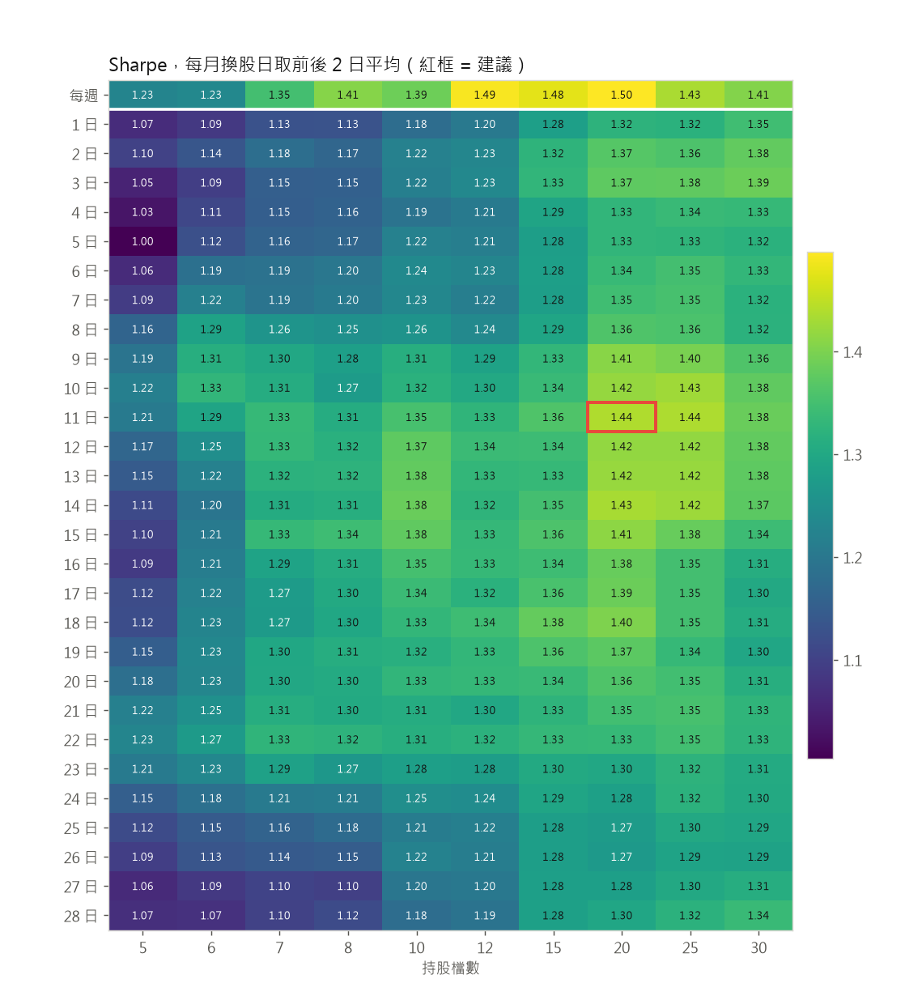
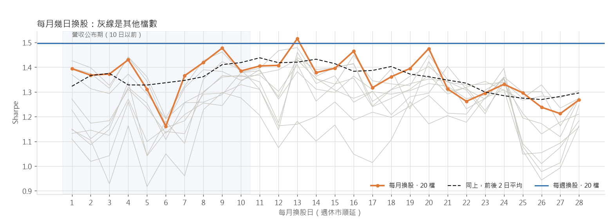
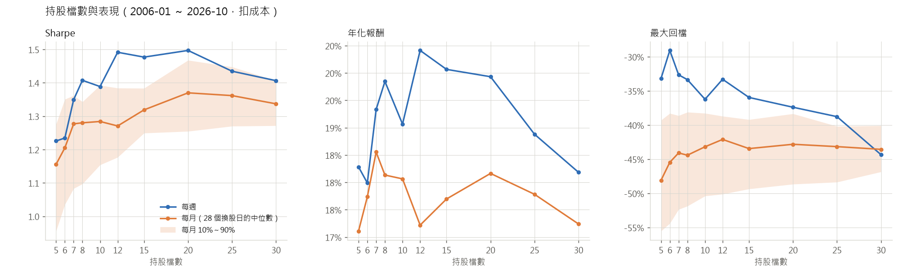

# 每週換股還是每月換股：結果

由 `twrank rebalance-report` 產生。需求見 [genesis/FIAT-rebalance.md](../../genesis/FIAT-rebalance.md)。所有數字都是 2006-01 ～ 2026-10、扣成本、同一套樣本外分數；沒列出的設定都和基本款相同。

## 換股日 × 持股檔數

未平滑的熱力圖：[heatmap.png](heatmap.png)；最大回檔：[heatmap_mdd.png](heatmap_mdd.png)。

* 前後 2 日平滑後，20 檔時最好的換股日是 **11 日**，9～15 日都差不多
* 但哪一天好**逐年不一致**：28 個換股日的逐年報酬排名，Kendall's W = 0.045（p = 0.62，20 檔）、0.038（p = 0.81，30 檔），和隨機排名分不出來
* 營收公布期（每月 10 日以前）換股和之後換股沒有差別：平均 Sharpe 1.35 對 1.34（Mann-Whitney p = 0.61，15～25 檔）

## 持股檔數

| 檔數 | 每週 Sharpe | 每月 Sharpe 中位數 | 每月 10% | 每月 90% | 每週回檔 | 每月回檔中位數 | 每週年成本 | 每月年成本 |
|---|---|---|---|---|---|---|---|---|
| 5 | 1.23 | 1.16 | 0.96 | 1.28 | -33% | -48% | 4.7% | 2.8% |
| 6 | 1.23 | 1.20 | 1.04 | 1.35 | -29% | -45% | 4.4% | 2.7% |
| 7 | 1.35 | 1.28 | 1.08 | 1.36 | -33% | -44% | 4.3% | 2.6% |
| 8 | 1.41 | 1.28 | 1.10 | 1.34 | -33% | -44% | 4.1% | 2.6% |
| 10 | 1.39 | 1.28 | 1.15 | 1.39 | -36% | -43% | 3.9% | 2.5% |
| 12 | 1.49 | 1.27 | 1.18 | 1.38 | -33% | -42% | 3.8% | 2.4% |
| 15 | 1.48 | 1.32 | 1.25 | 1.38 | -36% | -43% | 3.5% | 2.2% |
| 20 | 1.50 | 1.37 | 1.25 | 1.47 | -37% | -43% | 3.2% | 2.0% |
| 25 | 1.43 | 1.36 | 1.27 | 1.45 | -39% | -43% | 3.0% | 1.9% |
| 30 | 1.41 | 1.34 | 1.27 | 1.41 | -44% | -44% | 2.8% | 1.8% |

以「Sharpe 不低於高原的 90%」當作還能用：每週 7 檔以上、每月（中位數）7 檔以上。

## 跟著換股頻率一起看的設定（20 檔）

Sharpe，每月（28 個換股日的中位數）。列：續抱倍數（還在前 N × 倍數名內就續抱）；欄：分數平滑（週）

| 續抱＼平滑 | 1 | 2 | 4 | 8 | 13 |
|---|---|---|---|---|---|
| 2 | 1.31 | 1.34 | 1.35 | 1.35 | 1.37 |
| 3 | 1.34 | 1.35 | 1.34 | 1.37 | 1.36 |
| 4 | 1.33 | 1.36 | 1.37 | 1.33 | 1.32 |
| 6 | 1.34 | 1.35 | 1.34 | 1.33 | 1.29 |
| 8 | 1.34 | 1.33 | 1.31 | 1.27 | 1.32 |

Sharpe，每週。列：續抱倍數（還在前 N × 倍數名內就續抱）；欄：分數平滑（週）

| 續抱＼平滑 | 1 | 2 | 4 | 8 | 13 |
|---|---|---|---|---|---|
| 2 | 1.21 | 1.40 | 1.47 | 1.42 | 1.50 |
| 3 | 1.27 | 1.39 | 1.52 | 1.49 | 1.41 |
| 4 | 1.37 | 1.47 | 1.50 | 1.41 | 1.41 |
| 6 | 1.43 | 1.46 | 1.43 | 1.33 | 1.39 |
| 8 | 1.39 | 1.41 | 1.34 | 1.23 | 1.30 |

降半倉的檢查時點（所有續抱 × 平滑組合的中位數）：

| 換股 | 檢查時點 | Sharpe | 年化報酬 | 最大回檔 | 年週轉 |
|---|---|---|---|---|---|
| 每月 | 每天 | 1.30 | +16.6% | -45% | 11.8× |
| 每月 | 只在換股日 | 1.34 | +17.7% | -42% | 6.8× |
| 每月 | 每週第一個交易日 | 1.35 | +17.6% | -43% | 8.4× |
| 每週 | 每天 | 1.34 | +17.3% | -38% | 14.8× |
| 每週 | 只在換股日 | 1.41 | +18.5% | -37% | 11.2× |

## 同樣的 Walk-Forward 段落並排

**年化報酬**

| 段 | 每週 30 檔（基本款） | 每週 20 檔 | 每月 11 日 20 檔 | 每月 11 日 30 檔 |
|---|---|---|---|---|
| 1 | +17.9% | +22.0% | +16.5% | +20.1% |
| 2 | +18.1% | +19.4% | +15.2% | +15.2% |
| 3 | +5.3% | +10.2% | +7.6% | +2.4% |
| 4 | +19.6% | +19.3% | +25.7% | +23.4% |
| 5 | +10.7% | +13.2% | +4.7% | +8.8% |
| 6 | +18.0% | +19.8% | +16.6% | +15.1% |
| 7 | +7.8% | +10.6% | +11.4% | +8.9% |
| 8 | +31.5% | +30.9% | +26.0% | +26.3% |
| 9 | +20.2% | +24.4% | +21.9% | +23.1% |
| 10 | +31.0% | +28.3% | +34.2% | +31.1% |
| 全期 | +18.2% | +19.9% | +18.2% | +17.6% |

**Sharpe**

| 段 | 每週 30 檔（基本款） | 每週 20 檔 | 每月 11 日 20 檔 | 每月 11 日 30 檔 |
|---|---|---|---|---|
| 1 | 1.10 | 1.29 | 0.99 | 1.18 |
| 2 | 0.93 | 0.98 | 0.85 | 0.85 |
| 3 | 0.45 | 0.77 | 0.59 | 0.24 |
| 4 | 1.82 | 1.76 | 2.33 | 2.16 |
| 5 | 1.27 | 1.51 | 0.57 | 1.04 |
| 6 | 2.09 | 2.18 | 1.92 | 1.79 |
| 7 | 1.04 | 1.33 | 1.49 | 1.23 |
| 8 | 2.24 | 2.22 | 1.89 | 1.91 |
| 9 | 2.18 | 2.51 | 2.35 | 2.44 |
| 10 | 2.18 | 1.93 | 2.23 | 2.15 |
| 全期 | 1.41 | 1.50 | 1.40 | 1.37 |

**最大回檔**

| 段 | 每週 30 檔（基本款） | 每週 20 檔 | 每月 11 日 20 檔 | 每月 11 日 30 檔 |
|---|---|---|---|---|
| 1 | -24.9% | -21.6% | -22.6% | -23.7% |
| 2 | -35.7% | -31.6% | -34.9% | -36.5% |
| 3 | -16.7% | -16.8% | -17.7% | -20.4% |
| 4 | -13.5% | -14.5% | -11.3% | -11.0% |
| 5 | -10.4% | -9.5% | -12.4% | -10.9% |
| 6 | -3.9% | -4.1% | -6.0% | -4.5% |
| 7 | -7.8% | -8.7% | -6.7% | -6.9% |
| 8 | -15.8% | -16.3% | -16.0% | -16.2% |
| 9 | -7.0% | -6.2% | -7.1% | -8.4% |
| 10 | -8.7% | -9.5% | -10.7% | -10.5% |
| 全期 | -44.3% | -37.4% | -41.9% | -42.9% |

**年週轉（買＋賣）**

| 段 | 每週 30 檔（基本款） | 每週 20 檔 | 每月 11 日 20 檔 | 每月 11 日 30 檔 |
|---|---|---|---|---|
| 1 | 11.4× | 13.0× | 7.7× | 7.1× |
| 2 | 11.1× | 13.3× | 7.8× | 6.9× |
| 3 | 12.9× | 14.8× | 8.5× | 7.4× |
| 4 | 10.6× | 12.2× | 7.4× | 6.6× |
| 5 | 7.9× | 9.5× | 6.7× | 5.9× |
| 6 | 6.8× | 7.6× | 5.2× | 4.5× |
| 7 | 9.7× | 11.0× | 6.9× | 6.0× |
| 8 | 9.4× | 10.3× | 7.2× | 6.4× |
| 9 | 9.7× | 10.8× | 6.1× | 5.1× |
| 10 | 7.1× | 8.3× | 6.3× | 5.0× |
| 全期 | 9.5× | 11.0× | 6.9× | 6.0× |

全期年化交易成本：每週 30 檔（基本款） 2.79%、每週 20 檔 3.20%、每月 11 日 20 檔 2.02%、每月 11 日 30 檔 1.76%

每月 20 檔時，28 個換股日在各段的 Sharpe 範圍（換股日的運氣有多大）：

| 段 | 最低 | 中位數 | 最高 |
|---|---|---|---|
| 1 | 0.76 | 1.19 | 1.62 |
| 2 | 0.55 | 0.85 | 1.18 |
| 3 | -0.22 | 0.43 | 1.00 |
| 4 | 1.16 | 1.94 | 2.35 |
| 5 | 0.57 | 1.06 | 1.44 |
| 6 | 1.65 | 1.98 | 2.40 |
| 7 | 0.94 | 1.39 | 1.71 |
| 8 | 1.25 | 1.75 | 2.51 |
| 9 | 1.51 | 2.11 | 2.60 |
| 10 | 1.62 | 2.14 | 2.40 |

## 誠實版：每段只用訓練期挑換股方式與檔數

每段用 2004 年起到該段開始的資料，在每月（28 個換股日 × 10 種檔數）或每週（10 種檔數）裡挑 Sharpe 最高的，原封不動用在測試期：

| 段 | 每月挑到 | 測試期 Sharpe | 每週挑到 | 測試期 Sharpe |
|---|---|---|---|---|
| 1 | 23 日 8 檔 | 1.09 | 每週 25 檔 | 1.17 |
| 2 | 15 日 8 檔 | 0.72 | 每週 25 檔 | 0.96 |
| 3 | 23 日 5 檔 | -0.15 | 每週 25 檔 | 0.59 |
| 4 | 15 日 8 檔 | 1.96 | 每週 25 檔 | 1.79 |
| 5 | 15 日 8 檔 | 1.33 | 每週 25 檔 | 1.41 |
| 6 | 15 日 8 檔 | 2.31 | 每週 25 檔 | 2.01 |
| 7 | 15 日 8 檔 | 1.39 | 每週 12 檔 | 1.01 |
| 8 | 15 日 8 檔 | 1.03 | 每週 20 檔 | 2.22 |
| 9 | 20 日 12 檔 | 1.70 | 每週 12 檔 | 1.96 |
| 10 | 13 日 20 檔 | 2.10 | 每週 20 檔 | 1.93 |
| 平均 | | **1.35** | | **1.50** |
