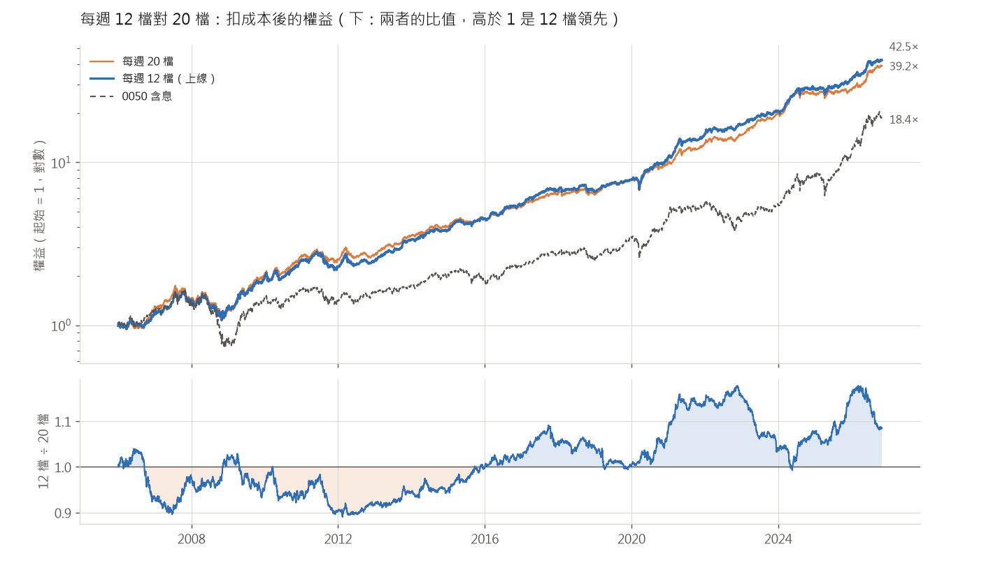
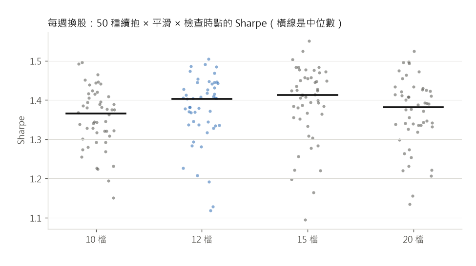

# 要持有幾檔：每週 12 檔對 20 檔

由 `twrank size` 與 `twrank size-report` 產生。2006-01 ～ 2026-10、扣成本、同一套樣本外分數；沒列出的設定都和基本款相同（續抱 4 × 檔數、4 週平滑、跌破 120 日 EMA 降半倉）。

換股頻率的掃描裡，每週 12 ～ 20 檔是 Sharpe 差不多的高原，第一版上線選了最高點的 20 檔。人工下單時每一檔每週都要處理，這裡比較高原較少的一端（12 檔）會不會吃虧。

## 全期（每週換股，各種檔數）

| 檔數 | 年化報酬 | Sharpe | 最大回檔 | 年化波動 | 年週轉 | 年成本 |
|---|---|---|---|---|---|---|
| 8 | +19.8% | 1.41 | -33.4% | 13.5% | 14.1× | 4.12% |
| 10 | +19.1% | 1.39 | -36.2% | 13.2% | 13.5× | 3.95% |
| **12** | +20.4% | 1.49 | -33.3% | 13.0% | 12.9× | 3.76% |
| 15 | +20.1% | 1.48 | -36.0% | 13.0% | 12.1× | 3.52% |
| **20** | +19.9% | 1.50 | -37.4% | 12.7% | 11.0× | 3.20% |
| 25 | +18.9% | 1.43 | -38.8% | 12.6% | 10.2× | 2.98% |
| 30 | +18.2% | 1.41 | -44.3% | 12.4% | 9.5× | 2.79% |

## 差距在雜訊範圍內

* 兩者的日報酬相關 0.948，報酬差的年化波動（追蹤誤差）4.2%：同一套分數、前 12 名本來就在前 20 名裡，差別只在多持有的 8 檔
* 區塊拔靴法（63 個交易日一塊、2,000 次）：12 檔減 20 檔的 Sharpe 差 -0.00（90% 區間 -0.14 ～ +0.13），12 檔比較高的機率 49%；對數報酬差每年 +0.4%（90% 區間 -1.4% ～ +2.2%），12 檔比較高的機率 64%

**十段 Walk-Forward**

| 段 | 期間 | 12 檔 年化 | 20 檔 年化 | 12 檔 Sharpe | 20 檔 Sharpe | 12 檔 回檔 | 20 檔 回檔 |
|---|---|---|---|---|---|---|---|
| 1 | 2006-01 ～ 2007-12 | +20.5% | +22.0% | 1.16 | 1.29 | -17.5% | -21.6% |
| 2 | 2008-01 ～ 2009-12 | +18.2% | +19.4% | 0.93 | 0.98 | -31.3% | -31.6% |
| 3 | 2010-01 ～ 2011-12 | +6.9% | +10.2% | 0.53 | 0.77 | -22.8% | -16.8% |
| 4 | 2012-01 ～ 2013-12 | +22.3% | +19.3% | 1.95 | 1.76 | -16.4% | -14.5% |
| 5 | 2014-01 ～ 2015-12 | +16.5% | +13.2% | 1.81 | 1.51 | -8.2% | -9.5% |
| 6 | 2016-01 ～ 2017-12 | +23.1% | +19.8% | 2.39 | 2.18 | -4.8% | -4.1% |
| 7 | 2018-01 ～ 2019-12 | +7.9% | +10.6% | 1.01 | 1.33 | -9.9% | -8.7% |
| 8 | 2020-01 ～ 2021-12 | +39.4% | +30.9% | 2.66 | 2.22 | -16.0% | -16.3% |
| 9 | 2022-01 ～ 2023-12 | +19.0% | +24.4% | 1.96 | 2.51 | -6.1% | -6.2% |
| 10 | 2024-01 ～ 2026-10 | +30.3% | +28.3% | 2.00 | 1.93 | -11.3% | -9.5% |

12 檔有 5 段年化報酬比較高、5 段 Sharpe 比較高。

**逐年**：21 年裡 12 檔有 13 年贏。差距常常到好幾個百分點，兩個方向都有（最好 +9.6%，2020 年；最差 -13.1%，2023 年）。

| 年 | 12 檔 | 20 檔 | 差距（百分點） |
|---|---|---|---|
| 2006 | +20.7% | +29.7% | -8.9 |
| 2007 | +19.1% | +13.6% | +5.5 |
| 2008 | -11.1% | -14.7% | +3.6 |
| 2009 | +56.2% | +66.1% | -9.8 |
| 2010 | +26.0% | +27.3% | -1.4 |
| 2011 | -9.4% | -4.8% | -4.6 |
| 2012 | +8.9% | +6.9% | +2.0 |
| 2013 | +35.4% | +31.6% | +3.8 |
| 2014 | +14.7% | +14.1% | +0.6 |
| 2015 | +17.4% | +11.7% | +5.7 |
| 2016 | +21.0% | +18.0% | +3.0 |
| 2017 | +23.2% | +19.9% | +3.3 |
| 2018 | -1.2% | -0.3% | -0.9 |
| 2019 | +17.3% | +21.8% | -4.6 |
| 2020 | +37.4% | +27.8% | +9.6 |
| 2021 | +38.4% | +31.6% | +6.8 |
| 2022 | +14.4% | +12.6% | +1.9 |
| 2023 | +22.2% | +35.2% | -13.1 |
| 2024 | +36.0% | +31.4% | +4.6 |
| 2025 | +13.4% | +5.7% | +7.7 |
| 2026 | +32.7% | +41.4% | -8.8 |

## 換成其他續抱、平滑設定也一樣

續抱倍數 2／3／4／6／8 × 分數平滑 1／2／4／8／13 週 × 降半倉只在換股日或每天檢查，共 50 種，每一種都拿 12 檔和 20 檔配對比較：

* Sharpe：12 檔贏 22 / 50 種，差距中位數 -0.005
* 年化報酬：12 檔贏 43 / 50 種，差距中位數 +0.5 個百分點
* 最大回檔：12 檔比較淺的有 44 / 50 種，差距中位數 +2.6 個百分點

| 檔數 | Sharpe 中位數 | 年化報酬中位數 | 最大回檔中位數 |
|---|---|---|---|
| 10 | 1.37 | +18.5% | -34.1% |
| 12 | 1.40 | +18.7% | -35.4% |
| 15 | 1.41 | +18.7% | -36.2% |
| 20 | 1.38 | +18.1% | -38.1% |

## 下單的工作量

從換股紀錄算（2006 ～ 2026）：

|  | 12 檔 | 20 檔 |
|---|---|---|
| 每週新買進 | 1.4 檔 | 1.9 檔 |
| 每週賣出 | 1.4 檔 | 1.9 檔 |
| 有換名單的週 | 73% | 79% |
| 每年買賣一輪 | 74 次 | 98 次 |
| 持有週數（中位數／平均） | 5／8.3 | 6／10.2 |

但名單一變，其他持股也要調回平均權重，所以真正要下單的檔數多很多。整數股帳戶（`twrank plan` 的預設：方案 B、手續費 6 折），2021 年以後：

| 資金 | 12 檔：每年下單日 | 每次下單幾檔 | 每年下單檔次 | 20 檔：每年下單日 | 每次下單幾檔 | 每年下單檔次 |
|---|---|---|---|---|---|---|
| 10 萬 | 36 | 12.4 | 451 | 39 | 18.8 | 738 |
| 30 萬 | 36 | 13.2 | 480 | 39 | 20.7 | 811 |
| 100 萬 | 36 | 13.6 | 492 | 39 | 21.5 | 844 |

12 檔每年少下 41% 的單。

**整數股的摩擦**：落後無摩擦回測的百分點／年（2021 年以後，零股滑價 0.00%）。每檔的金額比較大，整數股的零頭與最低手續費占比變小，小資金的摩擦反而比較少：

| 資金 | 12 檔 | 20 檔 |
|---|---|---|
| 10 萬 | 0.1 | 0.5 |
| 30 萬 | 0.0 | 0.1 |
| 100 萬 | 0.0 | 0.0 |

**交割**：代價在這裡。開盤跌停或停牌賣不掉、新股照買時，T+2 會短少那檔的市值；12 檔一檔約淨值的 8%，20 檔是 5%。100 萬、2006 年起（短少占淨值，下單日的 99% 分位／最大）：12 檔 0.9%／17.9%（33 個下單日有賣不掉的股票），20 檔 1.7%／10.6%（41 個）。最大的一次是兩檔同時賣不掉。12 檔的交割戶要多留淨值的 9% 左右（約一檔），20 檔是 5%。

## 結論：上線改用每週 12 檔

* 報酬與風險分不出高下：Sharpe 1.49 對 1.50、年化 +20.4% 對 +19.9%、最大回檔 -33.3% 對 -37.4%；拔靴法、十段、逐年、50 種設定都看不出哪一邊比較好
* 下單少四成左右，小資金的整數股摩擦也比較小
* 再少就開始掉：每週 10 檔以下 Sharpe 往下（8 檔 1.41、7 檔 1.35），個股風險也更集中，12 檔是高原較少的一端
* 要承擔的是：逐年和 20 檔可能差好幾個百分點（兩個方向都有）；一檔停牌或跌停賣不掉時卡住的錢比較多，交割戶多留淨值的 9%
